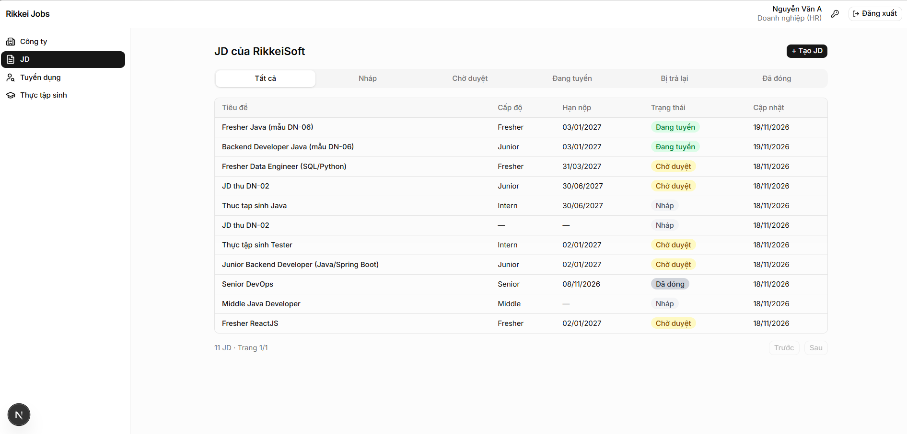
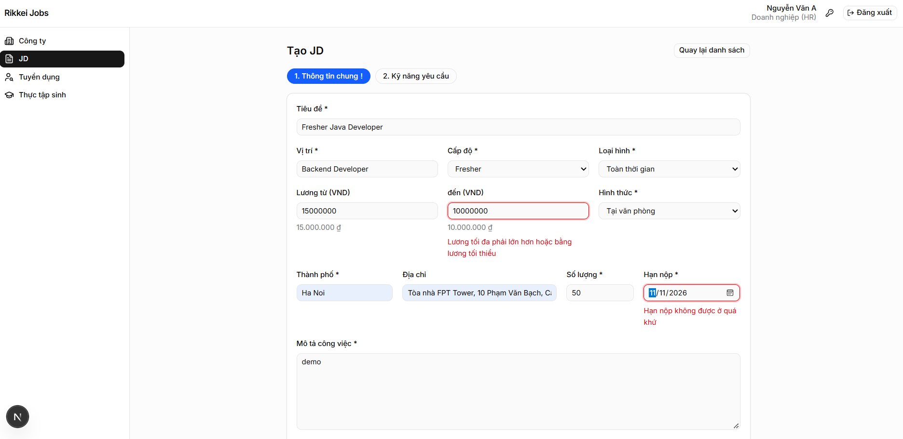
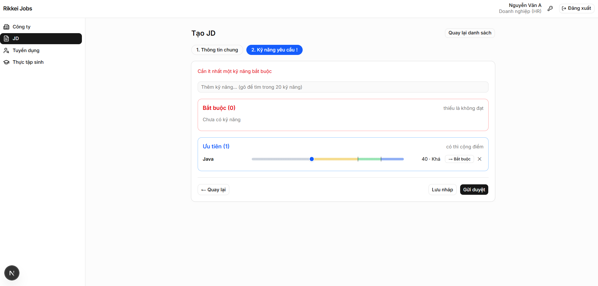
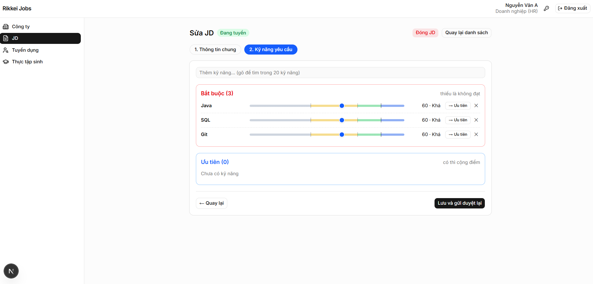
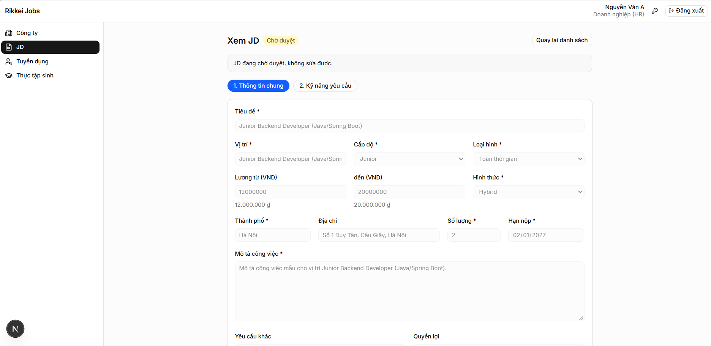

# DN-02 · JD: nhu cầu tuyển dụng theo vị trí, kỹ năng yêu cầu

| Mục | Giá trị |
| --- | --- |
| Mã task | DN-02 |
| Service | `company-service` (cổng 8085) qua `api-gateway`; đọc danh mục kỹ năng của `profile-service` (cổng 8082, `GET /skills`); tra email HR qua API nội bộ của `identity-service` (cổng 8081) |
| Frontend | `/hr/jobs` (danh sách), `/hr/jobs/new` (tạo), `/hr/jobs/{id}` (sửa hoặc chỉ xem) trong `web/src/app/(pages)/(app)/hr/jobs` |
| Phụ thuộc | DN-01, DN-05 (công ty, `company_hr`, `HrLockedFilter`), HS-01/HS-02 (danh mục 20 kỹ năng, `GET /skills`), UT-01 (hợp đồng `application-context`) |
| OpenAPI | [company-openapi.yaml](company-openapi.yaml) (tag `job`, `internal`) |
| Request mẫu | [DN-02.http](DN-02.http) |
| Thiết kế | [2026-11-17-dn-02-jobs-design.md](../superpowers/specs/2026-11-17-dn-02-jobs-design.md) |

## 1. Mục tiêu

- **HR** tạo, sửa, gửi duyệt, đóng JD của **đúng công ty mình**. Công ty lấy từ bảng `company_hr` theo `userId` của JWT; body không bao giờ quyết định `companyId`, `status`, `createdBy`, `reviewed*`, `rejectReason`.
- Kỹ năng yêu cầu chọn **từ danh mục** của profile-service, kèm **mức tối thiểu 1–100**, tách rõ **bắt buộc** (thiếu là không đạt) và **ưu tiên** (có thì cộng điểm). Đây là dữ liệu cho phần tính điểm khớp DN-06; DN-02 chỉ lưu.
- Văn bản tự do (mô tả, "Yêu cầu khác", quyền lợi) chỉ cho người đọc; yêu cầu ngoài danh mục (tiếng Nhật N3, Redis...) ghi vào "Yêu cầu khác".
- recruitment-service (UT-01) đọc ngữ cảnh JD qua `GET /internal/jobs/{jobId}/application-context`; company-service là producer thật của endpoint này.
- `jdCount` ở `GET /staff/companies` (DN-05) là số JD thật, mọi trạng thái trừ `DRAFT`.

Tiêu chí nghiệm thu:

1. JD không có kỹ năng bắt buộc → không gửi duyệt được.
2. Hạn nộp trong quá khứ hoặc lương min > max → báo lỗi.
3. hr1 sửa JD của công ty B → 404.
4. Sửa JD đã duyệt → trạng thái về `PENDING`.
5. Lưu được JD loại `INTERNSHIP` (TT-02 dùng).
6. PR vào `test`, tiêu đề bắt đầu `[DN-02]`, có cách chạy, dữ liệu mẫu, ảnh màn hình; OpenAPI có endpoint mới; làm đủ DB, BE, FE.

Ngoài phạm vi: duyệt / trả lại JD và màn "Duyệt JD" (DN-07); trang việc làm và chi tiết JD cho ứng viên, `job_views` (DN-04); tính điểm khớp `GET /jobs/{id}/match/{userId}` (DN-06); STAFF/ADMIN sửa JD hộ; trạng thái "Tạm dừng".

## 2. Cơ sở dữ liệu

Schema `company`, migration `V3__jobs.sql` (V1, V2 của DN-01/DN-05 giữ nguyên). SQL chạy được trên cả PostgreSQL và H2 `MODE=PostgreSQL`, không ghi tên schema. Sơ đồ ở [erd.md](../database/erd.md).

### `jobs`

| Cột | Kiểu | Ghi chú |
| --- | --- | --- |
| `id` | UUID, PK | |
| `company_id` | UUID, NOT NULL, FK → `companies.id` | index `idx_jobs_company_status_updated (company_id, status, updated_at)` cho danh sách của HR và đếm `jdCount` |
| `title` | VARCHAR(255), NOT NULL | ví dụ "Junior Backend Developer (Java/Spring Boot)" |
| `position` | VARCHAR(255) | tên vị trí ngắn |
| `level` | VARCHAR(10) | CHECK `INTERN`, `FRESHER`, `JUNIOR`, `MIDDLE`, `SENIOR` |
| `type` | VARCHAR(12) | CHECK `FULLTIME`, `PARTTIME`, `INTERNSHIP` |
| `quantity` | INTEGER | CHECK `>= 1` |
| `city` / `address` | VARCHAR(100) / VARCHAR(255) | |
| `work_mode` | VARCHAR(10) | CHECK `ONSITE`, `REMOTE`, `HYBRID` |
| `salary_min`, `salary_max` | BIGINT | VND, `>= 0`, CHECK `salary_min <= salary_max` khi có cả hai; để trống = thoả thuận |
| `description`, `requirements`, `benefits` | TEXT | `requirements` là "Yêu cầu khác" |
| `deadline` | DATE | ngày cuối nhận hồ sơ theo giờ `Asia/Ho_Chi_Minh`, nhận hết ngày đó |
| `status` | VARCHAR(10), NOT NULL, mặc định `DRAFT` | CHECK `DRAFT`, `PENDING`, `APPROVED`, `REJECTED`, `CLOSED` |
| `reviewed_by`, `reviewed_at`, `reject_reason` | UUID, TIMESTAMPTZ, VARCHAR(1000) | để sẵn cho DN-07 |
| `created_by` | UUID, NOT NULL | userId của HR tạo |
| `created_at`, `updated_at` | TIMESTAMPTZ | |
| `version` | BIGINT, NOT NULL, mặc định 0 | `@Version` chống ghi đè đồng thời, không đưa ra DTO |

Các cột nội dung để NULL được vì bản nháp chỉ bắt buộc `title`; điều kiện đầy đủ kiểm ở bước gửi duyệt.

### `job_skills`

| Cột | Kiểu | Ghi chú |
| --- | --- | --- |
| `job_id` | UUID, NOT NULL, FK → `jobs.id` ON DELETE CASCADE | PK `(job_id, skill_id)` |
| `skill_id` | UUID, NOT NULL | `skills.id` của profile-service, **không** có khoá ngoại chéo schema |
| `required` | BOOLEAN, NOT NULL | `true` bắt buộc, `false` ưu tiên |
| `min_score` | INTEGER, NOT NULL | CHECK `BETWEEN 1 AND 100` |

`min_score` là 1–100 (không phải 0–100): UT-02 coi `minScore <= 0` trong kết quả điểm khớp là lỗi hợp đồng (502 `MATCH_CONTRACT_ERROR`). API, zod và thanh trượt cùng giới hạn này. Tối đa 20 kỹ năng mỗi JD (bằng cỡ danh mục).

## 3. API

Qua gateway `http://localhost:8080/api/v1` (gateway có thêm `/api/v1/jobs/**` trong route `company`, `StripPrefix=2`; `/api/v1/companies/**` đã có từ DN-01). Thành công trả thẳng DTO, lỗi là `{code, message, errors?}`. Đặc tả đầy đủ: [company-openapi.yaml](company-openapi.yaml).

| Endpoint | Vai trò | Thành công | Lỗi chính |
| --- | --- | --- | --- |
| `GET /companies/me/jobs?status=&page=1&size=20` | `HR` | 200 `PageResponse<JobSummary>` (`id, title, level, status, deadline, updatedAt`), mới cập nhật trước | 400 `BAD_REQUEST` (page/size/status sai), 404 (HR chưa có công ty) |
| `POST /jobs` | `HR` | 201 `JobResponse`, `DRAFT` | 400 `VALIDATION_ERROR`, 403 `COMPANY_LOCKED`, 503 `EXTERNAL_UNAVAILABLE` |
| `GET /jobs/{id}` | `HR` | 200 `JobResponse` | 404 `NOT_FOUND` |
| `PUT /jobs/{id}` | `HR` | 200 `JobResponse` | 400, 403 `COMPANY_LOCKED`, 404, 409 `JOB_NOT_EDITABLE` / `CONFLICT`, 503 |
| `PUT /jobs/{id}/skills` (body là mảng) | `HR` | 200 `JobResponse` | như `PUT /jobs/{id}` |
| `POST /jobs/{id}/submit` | `HR` | 200 `JobResponse`, `PENDING` | 400 `VALIDATION_ERROR` (liệt kê mọi lỗi), 403, 404, 409 `INVALID_JOB_STATUS` |
| `POST /jobs/{id}/close` | `HR` | 200 `JobResponse`, `CLOSED` | 403, 404, 409 `INVALID_JOB_STATUS` |

Mọi endpoint còn có 401 `UNAUTHORIZED`, 401 `ACCOUNT_DISABLED` (HR bị cán bộ khoá, `HrLockedFilter`), 403 `FORBIDDEN` (token STAFF/ADMIN/CANDIDATE), 403 `MUST_CHANGE_PASSWORD`. Id trên đường dẫn không phải UUID, JSON hỏng, enum sai giá trị → 400 `BAD_REQUEST` (không có `errors`).

Quyền:

- `@PreAuthorize(Roles.HR)` trên từng method (không đặt ở mức class, để DN-04/DN-07 nới `GET /jobs/{id}` theo vai trò).
- JD của công ty khác và id không tồn tại cho **cùng một** 404 `NOT_FOUND` "Không tìm thấy JD" (lọc bằng `findByIdAndCompanyId`).
- Công ty `LOCKED`: `GET` vẫn 200; `POST /jobs`, `PUT`, `submit`, `close` → 403 `COMPANY_LOCKED`.

Body `JobRequest`: `title` (bắt buộc), `position`, `level`, `type`, `quantity`, `city`, `address`, `workMode`, `salaryMin`, `salaryMax`, `description`, `requirements`, `benefits`, `deadline` (`yyyy-MM-dd`), `skills` tuỳ chọn `[{skillId, required, minScore}]`.

- `PUT /jobs/{id}` thay **toàn bộ** thông tin chung: field không gửi hoặc `null` bị xoá (trừ `title`). Chuỗi rỗng hoặc chỉ có khoảng trắng ở trường tuỳ chọn lưu thành `null`.
- `skills` có mặt (kể cả `[]`) → thay toàn bộ kỹ năng **trong cùng transaction** với thông tin chung; vắng mặt → giữ nguyên. Frontend luôn lưu bằng **một** lời gọi `POST /jobs` hoặc `PUT /jobs/{id}` kèm `skills`, để JD `APPROVED` không bị hai lần đổi trạng thái và không lưu dở dang khi profile-service lỗi.
- Có `skills` thì company-service gọi `GET ${PROFILE_SERVICE_URL}/skills`, chuyển tiếp header `Authorization` của HR (RestClient, timeout kết nối/đọc 5 giây, không thử lại, không cache). profile-service tắt, timeout hoặc lỗi → 503 `EXTERNAL_UNAVAILABLE` "Không kiểm tra được danh mục kỹ năng, vui lòng thử lại.", trước khi ghi nên JD không đổi.

`JobResponse`: `id, companyId, title, position, level, type, quantity, city, address, workMode, salaryMin, salaryMax, description, requirements, benefits, deadline, status, rejectReason, reviewedAt, createdAt, updatedAt, skills`. `rejectReason` chỉ khác `null` khi `REJECTED`. `skills` sắp bắt buộc trước rồi `minScore` giảm dần; backend không trả tên kỹ năng, frontend ghép với danh mục `GET /skills`.

### Kiểm tra dữ liệu

Lỗi quy tắc nghiệp vụ → 400 `VALIDATION_ERROR`, message "Dữ liệu không hợp lệ", `errors` là map field → thông báo tiếng Việt.

| Mức | Khi nào | Điều kiện |
| --- | --- | --- |
| Mọi lần lưu | `POST /jobs`, `PUT /jobs/{id}` | `title` không rỗng, ≤ 255; `quantity >= 1`; `salaryMin`, `salaryMax >= 0`; `salaryMin <= salaryMax` khi có cả hai (`errors.salaryMax`); `deadline >= hôm nay` theo `Asia/Ho_Chi_Minh` (`errors.deadline`, áp dụng cả khi lưu nháp); độ dài chuỗi theo cột |
| Kỹ năng | `skills` trong `POST`/`PUT`, hoặc `PUT /jobs/{id}/skills` | tối đa 20, không trùng `skillId`, `minScore` nguyên 1–100, `required` không null, mọi `skillId` có trong danh mục (`errors.skills` hoặc `errors["skills[i].minScore"]`); mảng rỗng hợp lệ |
| Gửi duyệt | `submit`, và mọi lần sửa JD `APPROVED` | đủ `title`, `position`, `level`, `type`, `quantity`, `city`, `workMode`, `deadline`, `description`; `deadline >= hôm nay`; lương đúng quy tắc trên; ≥ 1 kỹ năng `required = true` (`errors.skills` "Cần ít nhất một kỹ năng bắt buộc"). `errors` liệt kê **mọi** điều kiện sai cùng lúc |

"Hôm nay" lấy từ bean `Clock` theo giờ Việt Nam: lúc 23:30 UTC ngày 17/11 (06:30 ngày 18/11 giờ VN) thì hạn nộp 17/11 đã là quá khứ.

### Mã lỗi mới (`CompanyErrorCode`)

| Mã | HTTP | Khi nào |
| --- | --- | --- |
| `JOB_NOT_EDITABLE` | 409 | sửa (`PUT /jobs/{id}`, `PUT /jobs/{id}/skills`) JD đang `PENDING` hoặc `CLOSED` — "JD đang chờ duyệt hoặc đã đóng, không sửa được" |
| `INVALID_JOB_STATUS` | 409 | `submit` khi JD không ở `DRAFT`/`REJECTED` (kể cả bấm gửi duyệt lần hai), `close` khi JD không ở `APPROVED` |

Xung đột `@Version` (hai lần lưu cùng lúc) → 409 `CONFLICT`. Lưu chỉ kỹ năng cũng tăng `version` của JD.

### API nội bộ cho UT-01 (không qua gateway)

`GET http://localhost:8085/internal/jobs/{jobId}/application-context`, header `X-Internal-Key` = `INTERNAL_SERVICE_KEY` (mặc định `dev-internal-key`). Gateway **không** có route `/internal/**`. company-service có `InternalKeyFilter` riêng (so hằng thời gian; khoá cấu hình rỗng từ chối tất cả); JWT không áp dụng và không thay được khoá. Hợp đồng đúng như UT-01 đã dựng (record `JobApplicationContext` của recruitment-service, [ut01-dependencies-openapi.yaml](ut01-dependencies-openapi.yaml)):

```json
{
  "jobId": "00000000-0000-0000-0003-000000000003", "companyId": "00000000-0000-0000-0000-0000000000a1",
  "jobTitle": "Thực tập sinh Tester", "companyName": "Công ty A", "status": "APPROVED",
  "deadline": "2027-01-03T00:00:00+07:00", "companyLocked": false, "hrEmails": ["hr1@rikkeijobs.test"]
}
```

(Ví dụ khi seed ngày 18/11/2026: hạn nộp 02/01/2027 → `deadline` 00:00 ngày 03/01/2027 giờ Việt Nam.)

- `deadline` = 00:00 **ngày kế tiếp** ngày hạn nộp theo giờ Việt Nam, vì UT-01 so `deadline.isAfter(now)`. JD chưa có hạn nộp (chỉ `DRAFT`) trả `createdAt` để không bao giờ "còn hạn".
- `companyLocked` = `companies.status = LOCKED`.
- `hrEmails`: HR của công ty có `company_hr.locked_at IS NULL` và `status = ACTIVE` ở identity, tra theo lô qua `POST /internal/users/lookup`. Không có HR → `[]`. identity lỗi → 503 `EXTERNAL_UNAVAILABLE`.
- Thiếu/sai khoá → 401 `INVALID_SERVICE_KEY`; JD không tồn tại → 404; `jobId` không phải UUID → 400. Không ghi `job_views`.

## 4. Vòng đời

```text
DRAFT ──submit──▶ PENDING ──(DN-07 duyệt)──▶ APPROVED ──close──▶ CLOSED
                     ▲         └──(DN-07 trả lại)──▶ REJECTED
                     │                                   │
                     └──────────── sửa rồi submit ───────┘
APPROVED ──HR sửa (PUT /jobs/{id} hoặc PUT /jobs/{id}/skills), qua kiểm tra như submit──▶ PENDING
```

| Trạng thái | Sửa | `submit` | `close` |
| --- | --- | --- | --- |
| `DRAFT` | được, giữ `DRAFT` | → `PENDING` | 409 `INVALID_JOB_STATUS` |
| `REJECTED` | được, giữ `REJECTED` | → `PENDING`, xoá `rejectReason` | 409 |
| `APPROVED` | được, **chuyển `PENDING`** sau khi qua kiểm tra gửi duyệt (không đạt → 400, JD vẫn `APPROVED`); giữ `reviewedBy/At` cũ | 409 | → `CLOSED` |
| `PENDING` | 409 `JOB_NOT_EDITABLE` | 409 | 409 |
| `CLOSED` | 409 `JOB_NOT_EDITABLE` | 409 | 409 |

Trong lúc chờ duyệt lại sau khi sửa JD `APPROVED`, `application-context` trả `status = PENDING` nên UT-01 tự chặn đơn mới; đơn đã nộp trước đó không bị ảnh hưởng.

## 5. Giao diện

- **`/hr/jobs`**: tiêu đề "JD của <tên công ty>", nút "+ Tạo JD"; tab Tất cả / Nháp / Chờ duyệt / Đang tuyển / Bị trả lại / Đã đóng (gọi `GET /companies/me/jobs?status=`); bảng Tiêu đề, Cấp độ, Hạn nộp, Trạng thái (nhãn màu), Cập nhật; phân trang. Bấm dòng `DRAFT`/`REJECTED`/`APPROVED` mở form sửa, `PENDING`/`CLOSED` mở chế độ chỉ xem. Công ty bị khoá: banner, ẩn "+ Tạo JD".
- **Form 2 bước** (`/hr/jobs/new`, `/hr/jobs/{id}`): "1. Thông tin chung" → "2. Kỹ năng yêu cầu", chuyển bước không gọi API. JD `REJECTED` có banner đỏ "Lý do trả lại: …" ở cả hai bước.
  - Bước 1: Tiêu đề; Vị trí · Cấp độ · Loại hình; Lương từ · đến · Hình thức; Thành phố · Địa chỉ · Số lượng · Hạn nộp; Mô tả; Yêu cầu khác · Quyền lợi. Dấu sao nghĩa là bắt buộc **khi gửi duyệt**; lưu nháp chỉ cần Tiêu đề.
  - Bước 2: ô "Thêm kỹ năng…" lọc trong danh mục; hai khối **Bắt buộc** (đỏ, "thiếu là không đạt") và **Ưu tiên** (xanh, "có thì cộng điểm"); mỗi dòng có thanh trượt 1–100 (vạch 40/70/85, nhãn "70 · Tốt"), nút chuyển khối, nút xoá. Kỹ năng mới vào khối Bắt buộc, mặc định 40.
  - **Lưu nháp** ở cả hai bước (lần đầu `POST /jobs`, sau đó `PUT /jobs/{id}`, luôn kèm `skills`); **Gửi duyệt** ở bước 2 (lưu rồi `submit`). Lỗi `VALIDATION_ERROR` hiện theo từng trường và chuyển về bước có lỗi (`skills` → bước 2). Khi đang lưu, form và các nút bị khoá.
  - JD `APPROVED`: nút "Lưu và gửi duyệt lại" kèm hộp xác nhận "JD sẽ chuyển về Chờ duyệt, ứng viên tạm thời không thấy JD cho tới khi được duyệt lại."; nút **Đóng JD** kèm xác nhận. JD `PENDING`/`CLOSED`: mọi ô chỉ đọc, ẩn nút lưu/gửi; `PENDING` ghi "JD đang chờ duyệt, không sửa được".

## 6. Cách chạy

Cần Docker (Postgres, MailHog), Java 21 + Maven, Node 24. Mỗi lệnh chạy từ gốc repo, mỗi tiến trình dài một terminal. So với DN-01, company-service cần thêm **profile-service** (danh mục kỹ năng) đang chạy.

```bash
docker compose --env-file .env -f infra/compose.yaml up -d postgres mailhog
(cd mock && npm ci && npm start)                                      # mock LMS :9000 (SSO của staff1, candidate1)
mvn -f server/pom.xml -pl services/identity-service,services/profile-service,services/company-service,api-gateway -am install -DskipTests
mvn -f server/services/identity-service/pom.xml spring-boot:run "-Dspring-boot.run.profiles=dev"   # :8081, seed tài khoản mẫu
mvn -f server/services/profile-service/pom.xml spring-boot:run                                     # :8082, danh mục 20 kỹ năng (Flyway)
mvn -f server/services/company-service/pom.xml spring-boot:run "-Dspring-boot.run.profiles=dev"    # :8085, seed Công ty A/B + 5 JD mẫu
mvn -f server/api-gateway/pom.xml spring-boot:run                                                  # :8080
(cd web && cp .env.example .env.local && npm ci && npm run dev -- --port 3000)                    # http://localhost:3000
```

Biến cấu hình mới của company-service: `PROFILE_SERVICE_URL` (`app.profile.base-url`, mặc định `http://localhost:8082`). `INTERNAL_SERVICE_KEY` dùng chung cho cả hai chiều (company → identity và recruitment → company). Lưu ý chạy Maven trên PowerShell (đặt `-D...` trong nháy, không dùng `-am spring-boot:run`) xem [DN-01](DN-01-company-hr.md#5-cách-chạy).

Muốn thử ứng tuyển (UT-01) vào JD thật, chạy thêm recruitment-service. profile-service chưa có CV (HS-04) nên tạm lấy PDF CV từ mock:

```powershell
# Terminal mock: JWT_SECRET phải giống identity; MOCK_CV_OWNER_ID là id của candidate1 (GET /api/v1/auth/me)
$env:JWT_SECRET = 'your_super_secret_jwt_key_at_least_256_bits_long_rikkei_jobs'
$env:MOCK_CV_OWNER_ID = '<id của candidate1>'
cd mock; npm.cmd start
# Terminal recruitment: ngữ cảnh JD lấy từ company-service thật, PDF CV từ mock
# Java không đọc .env. INTERNAL_SERVICE_KEY phải bằng khoá company-service nhận (mặc định 'dev-internal-key');
# để trống thì mọi lần ứng tuyển lỗi 503 DEPENDENCY_NOT_CONFIGURED.
# Nếu identity dùng JWT_SECRET khác mặc định thì đặt $env:JWT_SECRET giống hệt ở terminal này.
mvn -f server/pom.xml -pl services/recruitment-service -am install -DskipTests
$env:INTERNAL_SERVICE_KEY = 'dev-internal-key'
$env:COMPANY_SERVICE_URL = 'http://localhost:8085'
$env:PROFILE_SERVICE_URL = 'http://localhost:9000'
java -jar server/services/recruitment-service/target/recruitment-service-1.0.0-SNAPSHOT.jar   # :8083
```

Đặt lại 5 JD mẫu trên DB dev (chỉ xoá dữ liệu JD, không đụng bảng khác), rồi khởi động lại company-service với profile `dev`:

```sql
DELETE FROM company.job_skills;
DELETE FROM company.jobs;
```

Test backend không cần Postgres: `mvn -f server/pom.xml -B clean test` (company-service dùng H2 `MODE=PostgreSQL` + Flyway; profile-service và identity được giả lập bằng `MockRestServiceServer`/mock bean). Test của recruitment-service cần Testcontainers (Docker) hoặc một DB kiểm thử riêng qua `UT01_TEST_DB_URL`, xem [UT-02](UT-02-application-pipeline.md).

Đi các kịch bản bằng [DN-02.http](DN-02.http) và giao diện `/hr/jobs`.

## 7. Dữ liệu mẫu

Chỉ có khi chạy company-service với profile `dev` (`DEV_DATA_ENABLED=true`), chạy lại không tạo trùng. 5 JD của **Công ty A**, `created_by` = hr1, id `00000000-0000-0000-0003-00000000000{1..5}`. Các JD đều Hà Nội, Hybrid, 2 người, lương 10–20 triệu, địa chỉ "Số 1 Duy Tân, Cầu Giấy, Hà Nội"; hạn nộp tính theo `Clock` (hôm nay + 45 ngày) để seed không hết hạn. Seeder không gọi profile-service, dùng thẳng UUID kỹ năng cố định của `V2__skill_catalog.sql` (`JAVA` = `00000000-0000-0000-0001-000000000001`...).

| id (đuôi) | Tiêu đề | Cấp độ | Loại | Trạng thái | Kỹ năng / ghi chú |
| --- | --- | --- | --- | --- | --- |
| `…0001` | Junior Backend Developer (Java/Spring Boot) | JUNIOR | FULLTIME | `REJECTED` | lý do "Mức lương chưa rõ đơn vị, phần quyền lợi còn sơ sài."; bắt buộc `JAVA` 70, `OOP` 70, `SPRING_BOOT` 40, `SQL` 40, `REST_API` 40, `GIT` 70; ưu tiên `DOCKER` 40, `ENGLISH` 40, `AGILE` 20 |
| `…0002` | Fresher ReactJS | FRESHER | FULLTIME | `PENDING` | bắt buộc `REACTJS`, `JAVASCRIPT`, `HTML_CSS` 40 |
| `…0003` | Thực tập sinh Tester | INTERN | INTERNSHIP | `APPROVED` | bắt buộc `TESTING` 40; dùng để ứng tuyển thử (UT-01) |
| `…0004` | Middle Java Developer | MIDDLE | FULLTIME | `DRAFT` | chưa có hạn nộp, chưa có kỹ năng |
| `…0005` | Senior DevOps | SENIOR | FULLTIME | `CLOSED` | hạn nộp đã qua (hôm nay − 10 ngày) |

Tài khoản (seed của identity/company DN-01): `hr1@rikkeijobs.test` (Công ty A) và `hr2@rikkeijobs.test` (Công ty B), mật khẩu `Test@123`; `candidate1` đăng nhập SSO với `lmsUserId` `lms-sv-001`. `GET /staff/companies` cho Công ty A trả `jdCount = 4` (bỏ JD nháp).

Duyệt / trả lại JD thuộc DN-07, chưa có: JD HR gửi duyệt sẽ dừng ở `PENDING`. Seed chỉ có một JD `APPROVED` ("Thực tập sinh Tester"); dùng nó cho ca ứng tuyển, sửa JD đang tuyển hoặc đóng JD, và đặt lại 5 JD mẫu (mục 6) khi cần dùng lại. Cần thêm JD đang tuyển trên DB dev thì tạm thay bước duyệt bằng SQL, chỉ cho JD đã gửi duyệt qua giao diện (đã đủ điều kiện):

```sql
UPDATE company.jobs SET status = 'APPROVED', reviewed_at = now() WHERE status = 'PENDING';
```

## 8. Ca kiểm thử

| # | Ca | Cách thử | Kết quả mong đợi | Test tự động |
| --- | --- | --- | --- | --- |
| 1 | Tạo nháp, `INTERNSHIP` (tiêu chí 5) | `DN-02.http` 3a, 3b | 201 `DRAFT`, `companyId` = A dù body gửi khác; `type = INTERNSHIP` đọc lại đúng | `JobApiTest` (`createWithTitleOnlyIsDraftOfOwnCompany`, `createAndUpdateInternshipType`), `JobPersistenceTest` |
| 2 | Hạn nộp quá khứ, lương min > max (tiêu chí 2) | 3c, 3d; giao diện | 400 `errors.deadline`, `errors.salaryMax`; hạn nộp đúng hôm nay giờ VN được | `JobApiTest`, `JobRulesTest.todayUsesVietnamTime` |
| 3 | Kỹ năng sai | 3e, 3f | ngoài danh mục → 400 `errors.skills`; trùng, `minScore` 0/101, > 20 kỹ năng → 400; profile tắt → 503, JD không đổi | `JobApiTest` (`unknownSkillRejectedAndNothingWritten`, `invalidSkillPayloadRejected`), `HttpSkillCatalogClientTest` |
| 4 | Gửi duyệt thiếu kỹ năng bắt buộc (tiêu chí 1) | 4a, 4d; bước 2 của form | 400, `errors` liệt kê mọi trường thiếu, `errors.skills`; form chuyển về bước 2 | `JobLifecycleApiTest.submitListsAllMissingFields`, `JobRulesTest.submitNeedsRequiredSkill` |
| 5 | Ma trận trạng thái | 4f–4h, 5c, 8d, 8f | sửa `PENDING`/`CLOSED` → 409 `JOB_NOT_EDITABLE`; gửi lần hai → 409 `INVALID_JOB_STATUS`; `REJECTED` → `PENDING`, `rejectReason` null; đóng chỉ từ `APPROVED` | `JobLifecycleApiTest`, `JobApiTest.editApprovedGoesBackToPending` |
| 6 | Sửa JD đã duyệt → `PENDING` (tiêu chí 4) | 8d; giao diện "Lưu và gửi duyệt lại" | 200 `PENDING`; bỏ hết kỹ năng bắt buộc → 400, JD vẫn `APPROVED` | `JobApiTest.editApprovedGoesBackToPending` |
| 7 | Công ty khác (tiêu chí 3) | 6a, 6b, 2d | 404 giống id không tồn tại; hr2 không thấy JD của A; thay kỹ năng JD của A → 404, danh mục không bị gọi | `JobApiTest.otherCompanyCannotReplaceSkills`, `JobLifecycleApiTest.otherCompanyAndLocked` |
| 8 | Vai trò, HR bị khoá, công ty LOCKED | 6d | STAFF/CANDIDATE → 403; HR bị khoá → 401 `ACCOUNT_DISABLED`; công ty LOCKED: GET 200, ghi → 403 `COMPANY_LOCKED` | `JobApiTest.rolesAndLockedCompany`, `JobLifecycleApiTest.otherCompanyAndLocked` |
| 9 | Danh sách | 2a–2c | lọc đúng, `total` đúng, `status` sai → 400 | `JobApiTest.listMineFiltersAndPages` |
| 10 | `application-context` | 7a–7e, 8e | body đúng hợp đồng (deadline 00:00 ngày kế tiếp +07:00, `hrEmails` bỏ HR bị khoá); thiếu/sai khoá → 401; id lạ → 404; qua gateway → 404 | `InternalJobContextApiTest` |
| 11 | `jdCount` | `DN-05.http` 2a | đếm mọi trạng thái trừ `DRAFT` | `StaffCompanyListApiTest.jdCountCountsNonDraftJobs`, `JobPersistenceTest.countExcludingDraft` |
| 12 | Seeder | khởi động profile `dev` hai lần | đủ 5 JD/5 trạng thái, không trùng | `DevDataSeederTest` |
| 13 | Gateway | mọi request `{{gw}}/jobs/...` | `/api/v1/jobs/**` tới company-service | `CompanyRouteIntegrationTest` |

Tên lớp test là các lớp trong `server/services/company-service/src/test` và `server/api-gateway/src/test`.

## 9. Kết quả xác minh

Đã chạy trên nhánh `feature/DN-02-jobs`, ngày 18/11/2026:

- `mvn -f server/pom.xml -B clean test`: lần chạy thường dừng ở recruitment-service (46 lỗi, cả 46 do Testcontainers không tìm được Docker: Docker Desktop trả 400 cho client Testcontainers 1.19.8); 10 module trước đó SUCCESS, ai-service bị bỏ qua. Chạy lại với `UT01_TEST_DB_URL` trỏ tới một database kiểm thử riêng, trống (`rikkei_jobs_ut01_test`, không phải DB dev): **BUILD SUCCESS, 12 module, 700 test, 0 lỗi, 1 test có sẵn bị skip** (company-service 165 test, recruitment-service 77 test). Sau lượt sửa cuối (thêm `JobOptimisticLockApiTest`, company-service còn 166 test), chạy lại `clean test` toàn backend trừ recruitment-service (không sửa gì ở module này): BUILD SUCCESS.
- `web/`: `npm run type-check` và `npm run build` thành công (có route `/hr/jobs`, `/hr/jobs/new`, `/hr/jobs/[id]`); `npm run lint`: 0 lỗi, 1 cảnh báo có sẵn ở `commitlint.config.mjs`.
- `company-openapi.yaml`: `postman spec lint docs/api/company-openapi.yaml --issueType=syntax` báo "No issues found"; parse bằng `js-yaml` (trong `web/node_modules`) được 15 path.
- Chạy toàn luồng theo mục 6 (Postgres và MailHog trong Docker; mock; identity, company-service profile `dev`; profile-service; recruitment-service với PDF CV từ mock; gateway; web dev). Trước khi chạy đã xoá các dòng của `company.job_skills`, `company.jobs` rồi khởi động company-service để seed lại 5 JD:
  - hr1 đăng nhập → `/hr/jobs` hiện đủ 5 JD, mỗi JD một nhãn trạng thái, "5 JD · Trang 1/1".
  - Mở "Junior Backend Developer (Java/Spring Boot)": banner "Lý do trả lại: Mức lương chưa rõ đơn vị, phần quyền lợi còn sơ sài."; sửa lương từ 10 thành 12 triệu; bước 2 hiện 6 bắt buộc / 3 ưu tiên đúng seed; kéo SQL lên 55 ("55 · Khá"), chuyển Docker sang Bắt buộc, tìm "Lin" và thêm Linux → Gửi duyệt → về danh sách, báo "Đã gửi duyệt", JD thành "Chờ duyệt". `GET /jobs/{id}`: `PENDING`, `rejectReason` null, `salaryMin` 12000000, 10 kỹ năng đúng như đã chỉnh.
  - Mở lại JD đó: "Xem JD", "JD đang chờ duyệt, không sửa được.", mọi ô bị khoá; bước 2 không có ô thêm kỹ năng, 10 thanh trượt bị khoá, không có nút lưu/gửi.
  - "+ Tạo JD" → điền bước 1 → Lưu nháp: URL chuyển sang `/hr/jobs/{id}` mới, "Đã lưu". Bước 2 thêm SQL, Docker rồi chuyển cả hai sang Ưu tiên → Gửi duyệt: ở lại bước 2, nút bước 2 có dấu lỗi, thông báo "Cần ít nhất một kỹ năng bắt buộc" (zod chặn trước khi gọi API). Lưu nháp rồi gọi thẳng `POST /jobs/{id}/submit` → 400 `VALIDATION_ERROR`, `errors.skills` = "Cần ít nhất một kỹ năng bắt buộc".
  - `application-context` của "Thực tập sinh Tester" bằng `X-Internal-Key` → 200 `status` `APPROVED`, `deadline` `2027-01-03T00:00:00+07:00` (hạn nộp 02/01/2027), `companyLocked` false, `hrEmails` [hr1, hr-new]; thiếu khoá → 401 `INVALID_SERVICE_KEY`; gọi qua gateway → 404.
  - candidate1 (SSO `lms-sv-001`) `POST /api/v1/recruitment/jobs/{…0003}/apply` với CV mẫu của mock → 201 `SUBMITTED`; MailHog nhận 2 email "Có đơn ứng tuyển mới: Thực tập sinh Tester" gửi hr1 và hr-new.
  - **Sau đó** mở JD "Đang tuyển" đó, sửa Số lượng 2 → 3, "Lưu và gửi duyệt lại" → hộp xác nhận đúng nội dung → xác nhận → về danh sách, báo "Đã lưu và gửi duyệt lại", JD thành "Chờ duyệt". `application-context` giờ trả `PENDING`; một ứng viên khác ứng tuyển JD này → 409 "Vị trí hiện không nhận hồ sơ ứng tuyển."; đơn của candidate1 vẫn `SUBMITTED`.
  - Request trong `DN-02.http` (mục 2, 3, 4, 6, 7, 8f) cho đúng kết quả ghi trong file: 3a `companyId` vẫn là A và `DRAFT` dù body gửi B/`APPROVED`; 3b `INTERNSHIP` lưu được, kỹ năng bắt buộc đứng trước; 3c/3d/3e/3f 400 đúng khoá `errors`; 4a liệt kê mọi trường thiếu; 4d 400 `errors.skills`; 4f `PENDING`, 4g 409 `INVALID_JOB_STATUS`; sửa JD `PENDING`/`CLOSED` → 409 `JOB_NOT_EDITABLE`; đóng JD `DRAFT`/`PENDING` → 409; hr2 xem, sửa, thay kỹ năng JD của A → 404 giống id không tồn tại; token CANDIDATE `POST /jobs` và token STAFF `GET /jobs/{id}` → 403; JWT thay cho khoá nội bộ → 401; JD nháp chưa có hạn nộp → `deadline` = `createdAt`. `GET /staff/companies` (staff1): Công ty A `jdCount` 5 (1 `CLOSED` + 4 `PENDING`, bỏ 4 `DRAFT`).
  - Tắt profile-service rồi `PUT /jobs/{id}/skills` → 503 `EXTERNAL_UNAVAILABLE` "Không kiểm tra được danh mục kỹ năng, vui lòng thử lại.", kỹ năng và `updatedAt` của JD không đổi; `PUT /jobs/{id}` không kèm `skills` vẫn 200.
- Sau lượt sửa form (đặt lại cả danh sách kỹ năng sau khi lưu): thêm kỹ năng bắt buộc vào JD có sẵn rồi "Gửi duyệt" → console không còn cảnh báo trùng `key`, kỹ năng lưu đúng; JD bị gửi duyệt từ nơi khác trong lúc form còn thay đổi chưa lưu → "Lưu nháp" báo "JD vừa được cập nhật ở nơi khác, đã tải lại", danh sách kỹ năng khớp server.
- Người làm task kiểm tra lại trên giao diện với dữ liệu seed (hr1, hr2, candidate1, staff1), đạt: danh sách và lọc theo trạng thái; sửa JD bị trả lại (banner lý do, thanh trượt đổi bậc đúng mốc 40/70/85, chuyển khối, thêm kỹ năng) rồi gửi duyệt; JD chờ duyệt chỉ xem; tạo JD mới loại Thực tập với lỗi hạn nộp quá khứ, lương min > max, số lượng quá lớn; gửi duyệt thiếu kỹ năng bắt buộc bị chặn ở bước 2, bấm gửi hai lần chỉ gửi một lần; candidate1 ứng tuyển JD đang tuyển qua `/candidate/applications/new?jobId=…`, MailHog nhận email cho HR, nộp lại → 409; sửa JD đang tuyển → hộp xác nhận → Chờ duyệt, ứng tuyển lại bị chặn; hr2 mở JD của Công ty A → "Không tìm thấy JD"; cột Số JD ở `/staff/companies` đúng.
- Chưa thử tay: đóng JD `APPROVED`, công ty `LOCKED` và HR bị khoá; các ca này có test tự động ở mục 8.

**Ảnh minh chứng** (chụp 2026-11-19 khi chạy lại toàn hệ thống; Công ty A đã được đổi tên thành "RikkeiSoft", danh sách có thêm JD tạo trong các lần thử và hai JD mẫu của DN-06):

| Ca (mục 8) | Ảnh | Nội dung |
| --- | --- | --- |
| 9 |  | `/hr/jobs`: tab theo trạng thái, nhãn màu Nháp / Chờ duyệt / Đang tuyển / Đã đóng, phân trang "11 JD · Trang 1/1" |
| 2 |  | Tạo JD: lương tối đa nhỏ hơn tối thiểu và hạn nộp ở quá khứ báo lỗi ngay dưới từng ô; nút bước 1 có dấu lỗi |
| 4 |  | Chỉ có kỹ năng ưu tiên, bấm Gửi duyệt: "Cần ít nhất một kỹ năng bắt buộc", ở lại bước 2 |
| — |  | Bước 2 của JD đang tuyển: khối Bắt buộc / Ưu tiên, thanh trượt có mốc 40/70/85 và nhãn "60 · Khá", nút chuyển khối và nút xoá (chỉ mở xem, không lưu) |
| 5 |  | JD "Chờ duyệt": "JD đang chờ duyệt, không sửa được.", mọi ô bị khoá |

Hộp xác nhận "Lưu và gửi duyệt lại" (ca 6) không chụp lại; đã kiểm ở lần chạy ngày 18/11/2026 phía trên và có test tự động ở mục 8.
