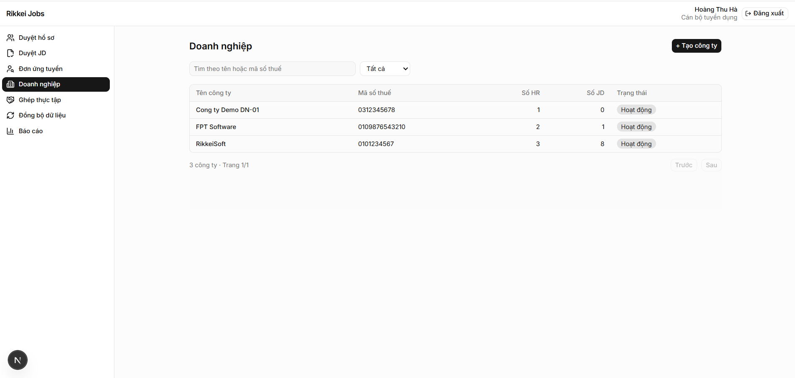
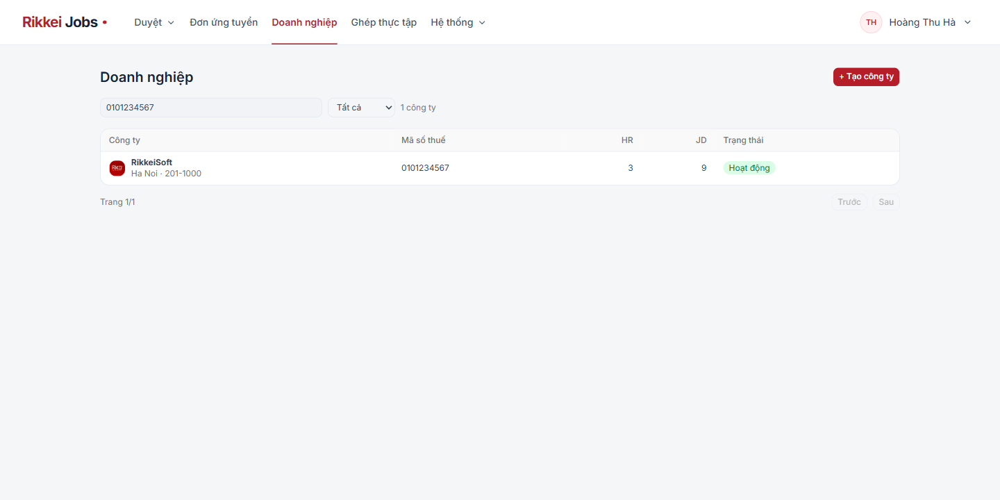
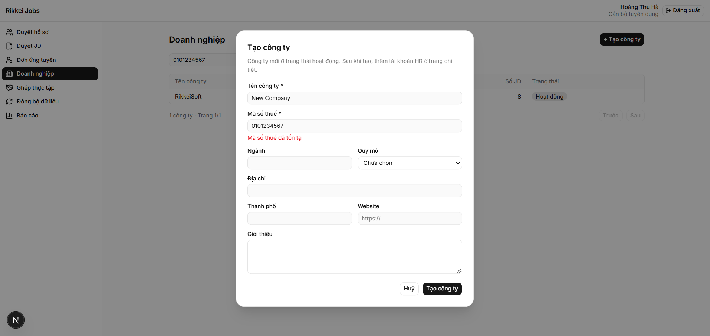
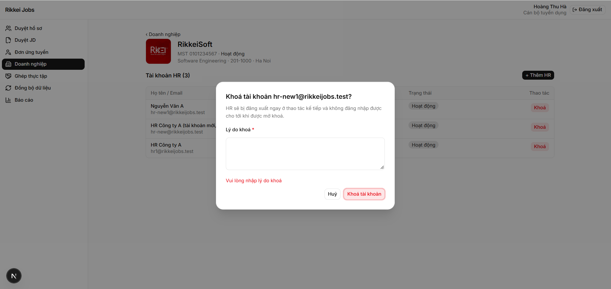
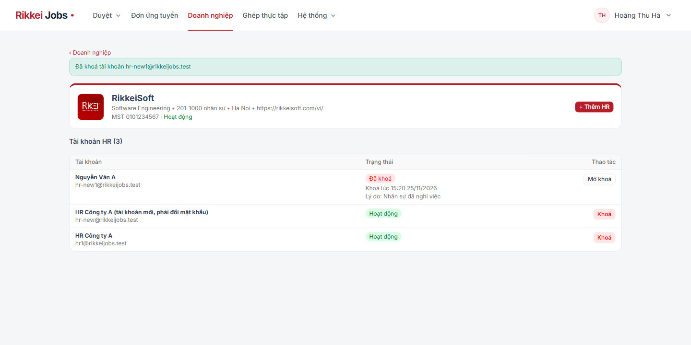
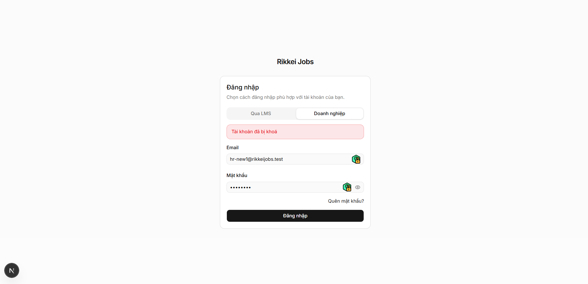
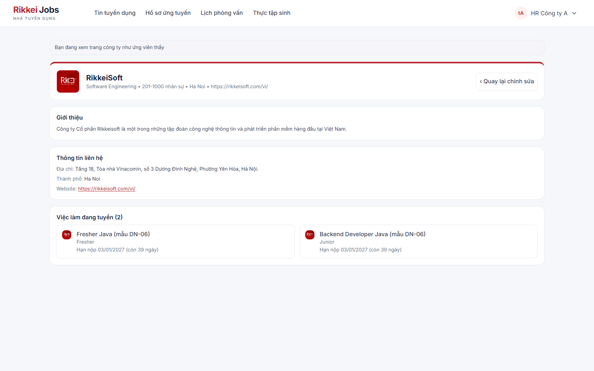

# DN-05 · Giao diện doanh nghiệp: hồ sơ công ty và tài khoản HR

| Mục | Giá trị |
| --- | --- |
| Mã task | DN-05 |
| Service | `company-service` (8085) và `identity-service` (8081) qua `api-gateway` (8080) |
| Frontend | `/staff/companies`, `/staff/companies/[id]` (cán bộ); `/hr/company`, `/hr/company/preview` (HR) |
| Phụ thuộc | NT-01 (đăng nhập, JWT), DN-01 (hồ sơ công ty, tài khoản HR, API nội bộ) |
| OpenAPI | [company-openapi.yaml](company-openapi.yaml), [identity-openapi.yaml](identity-openapi.yaml) (tag `internal`) |
| Request mẫu | [DN-05.http](DN-05.http) |
| Thiết kế | [spec DN-05](../superpowers/specs/2026-11-12-dn-05-company-hr-ui-design.md) |

## 1. Mục tiêu

- **Cán bộ (`STAFF`)** xem danh sách công ty (tìm theo tên hoặc mã số thuế, lọc trạng thái, phân trang), mở chi tiết một công ty, **khoá / mở khoá** từng tài khoản HR (khoá bắt buộc có lý do) và thêm HR mới.
- **HR** sửa hồ sơ công ty, đổi logo (có xem trước ngay và báo trạng thái lưu) và nút **"Xem như ứng viên"** để xem trang công ty như ứng viên thấy.
- HR bị cán bộ khoá thì mất quyền ngay, kể cả khi token còn hạn: gọi API bị 401 `ACCOUNT_DISABLED`, giao diện đưa về `/login`; đăng nhập báo "Tài khoản đã bị khoá".

## 2. Cơ sở dữ liệu

Hai migration mới, mỗi cái thêm cột, không đụng dữ liệu cũ:

| Service | Migration | Nội dung |
| --- | --- | --- |
| identity-service | `V2__user_admin_lock.sql` | `users.locked_reason VARCHAR(500)`, `users.locked_at TIMESTAMPTZ` |
| company-service | `V2__company_hr_lock.sql` | `company_hr.locked_at TIMESTAMPTZ` (bản sao để chặn nhanh) |

Quy tắc: **`locked_at` khác null = khoá bởi cán bộ**; identity là nguồn sự thật, `company_hr.locked_at` chỉ là bản sao. Cột `users.status` / `locked_until` cũ vẫn là **khoá tạm** do sai mật khẩu 5 lần (NT-01). Trạng thái hiển thị là giá trị suy ra:

| Trường | Cách tính |
| --- | --- |
| `status` | `LOCKED` khi `lockedAt != null`, ngược lại `ACTIVE` |
| `tempLockedUntil` | `locked_until` nếu còn ở tương lai và `locked_at` null, ngược lại `null` |

## 3. API

Qua gateway `http://localhost:8080/api/v1` (gateway bỏ `/api/v1`). Route `company` của gateway nay gom thêm `/api/v1/staff/hr-accounts/**`. Thành công trả thẳng DTO, lỗi là `{code, message, errors?}`. Đặc tả đầy đủ: [company-openapi.yaml](company-openapi.yaml).

| Endpoint | Vai trò | Thành công | Lỗi chính |
| --- | --- | --- | --- |
| `GET /staff/companies?q=&status=&page=&size=` | `STAFF` | 200 `PageResponse<StaffCompanyItem>` (thêm `logoUrl`, `city`, `size` để hiện logo và dòng phụ) | 400 `BAD_REQUEST` (page/size/status sai) |
| `GET /staff/companies/{id}` | `STAFF` | 200 `StaffCompanyDetail` (kèm `hrAccounts`) | 404 `NOT_FOUND`, 503 `EXTERNAL_UNAVAILABLE` |
| `POST /staff/hr-accounts/{userId}/lock` body `{reason}` | `STAFF` | 200 `StaffHrAccount` | 400 `VALIDATION_ERROR` (lý do trống / > 500 ký tự), 404 `NOT_FOUND`, 503 |
| `POST /staff/hr-accounts/{userId}/unlock` | `STAFF` | 200 `StaffHrAccount` | 404 `NOT_FOUND`, 503 |

Các endpoint DN-01 (`POST /staff/companies`, `POST /staff/companies/{id}/hr-accounts`, `GET|PUT /companies/me`, logo) giữ nguyên, xem [DN-01](DN-01-company-hr.md). Mọi endpoint còn có 401 `UNAUTHORIZED`, 403 `FORBIDDEN` (không phải STAFF), 403 `MUST_CHANGE_PASSWORD`.

Quy tắc dữ liệu:

- **Danh sách**: `q` tìm theo tên hoặc mã số thuế, không phân biệt hoa thường nhưng **phân biệt dấu tiếng Việt**; `%` và `_` trong `q` được thoát nên tìm đúng nghĩa đen. `status` là `ACTIVE` hoặc `LOCKED` (trạng thái **công ty**). `page` từ 1 (mặc định 1), `size` mặc định 20, tối đa 100. Sắp xếp `createdAt` giảm dần. `hrCount` là số HR của công ty; `jdCount` là số JD của công ty ở **mọi trạng thái trừ `DRAFT`** (từ DN-02, đếm bằng một truy vấn gom nhóm cho cả trang, xem [DN-02](DN-02-jobs.md)); trước DN-02 trường này luôn 0.
- **Chi tiết**: gồm mọi field của `CompanyResponse` và `hrAccounts[]` (`userId`, `email`, `fullName`, `status`, `lockedReason`, `lockedAt`, `tempLockedUntil`), sắp xếp theo email. company-service lấy trạng thái từ identity qua API nội bộ; HR có trong `company_hr` nhưng không còn ở identity bị bỏ khỏi danh sách (ghi log WARN).
- **Khoá**: `reason` bắt buộc, cắt khoảng trắng rồi không được rỗng, tối đa 500 ký tự. Khoá lại tài khoản đã khoá vẫn trả 200 (cập nhật lý do). `userId` không phải HR của một công ty nào → 404.
- **Mở khoá**: xoá `locked_reason`, `locked_at`, `locked_until`, đưa bộ đếm sai mật khẩu về 0. Tài khoản không bị cán bộ khoá thì không đổi gì và trả 200.
- **Thứ tự ghi**: identity trước, rồi chép `locked_at` về `company_hr`. Identity lỗi thì bản sao không đổi (503). Cả hai bước nằm ngoài transaction.

### API nội bộ mới của identity-service (không qua gateway)

Cùng khoá `X-Internal-Key` như DN-01 (thiếu hoặc sai → 401 `INVALID_SERVICE_KEY`).

| Endpoint | Việc | Lỗi |
| --- | --- | --- |
| `PATCH /internal/users/{id}/lock` body `{reason}` | Khoá HR, trả `InternalUserStatusResponse` | 400 `VALIDATION_ERROR`, 404 `NOT_FOUND` (không có user), 409 `CONFLICT` (không phải HR) |
| `PATCH /internal/users/{id}/unlock` | Mở khoá HR, trả `InternalUserStatusResponse` | 404, 409 như trên |
| `POST /internal/users/lookup` body `{userIds}` | Tra cứu hàng loạt, trả mảng `InternalUserStatusResponse` | 400 `VALIDATION_ERROR` (rỗng hoặc > 100 id); id không có bị bỏ qua |

`POST /internal/users` (tạo HR) vẫn trả `InternalUserResponse` như DN-01; chỉ ba endpoint trên dùng `InternalUserStatusResponse` (`userId`, `email`, `fullName`, `role`, `companyId`, `status`, `lockedReason`, `lockedAt`, `tempLockedUntil`).

### Mã lỗi `ACCOUNT_DISABLED` ("Tài khoản đã bị khoá")

| Ở đâu | HTTP |
| --- | --- |
| `POST /auth/login` (chỉ khi mật khẩu đúng), `POST /auth/sso` | **403** |
| Bộ lọc JWT của identity-service (mọi đường dẫn, kể cả `/auth/**`, đọc DB mỗi request) | **401** |
| `HrLockedFilter` của company-service (đọc `company_hr.locked_at` mỗi request) | **401** |

Đăng nhập sai mật khẩu vào tài khoản bị cán bộ khoá trả 401 `INVALID_CREDENTIALS` và tăng bộ đếm như mọi tài khoản khác, để không ai dò được email nào đang bị khoá. Mở khoá đưa bộ đếm về 0.

Quên mật khẩu với tài khoản bị khoá vẫn trả 200 nhưng **không** cấp token và không gửi thư; đặt lại mật khẩu cũ không mở khoá. Khoá cán bộ khác khoá tạm: `ACCOUNT_LOCKED` (429) vẫn là khoá 15 phút do sai mật khẩu.

> **Phạm vi chặn.** UT-02 đã nối recruitment-service với `POST /internal/users/lookup`: HR bị khoá nhận 401 ngay cả khi JWT còn hạn; identity tạm lỗi thì recruitment trả 503. Các service khác có API HR cần kiểm tra trạng thái tương tự trước khi xử lý token cũ.

## 4. Giao diện

**Khung điều hướng (làm lại)**: HR và STAFF dùng chung `ManagerShell`, thanh ngang màu đỏ Rikkei thay cho menu dọc. HR có 5 mục phẳng. STAFF gom nhóm: "Duyệt ▾" (Duyệt hồ sơ, Duyệt JD) · Đơn ứng tuyển · Doanh nghiệp · Ghép thực tập · "Hệ thống ▾" (Đồng bộ dữ liệu, Báo cáo). Menu tài khoản có "Đổi mật khẩu" (chỉ HR) và "Đăng xuất". Từ 768px trở xuống thanh thu thành nút ☰. Màu của khung nằm trong token `.admin-theme`; mentor, admin và ứng viên giữ giao diện cũ.

**Đầu trang công ty (`CompanyHeader`)**: viền đỏ 4px phía trên, logo, tên và dòng thông tin (ngành • quy mô • thành phố • website); dùng chung ở `/hr/company`, trang xem trước và chi tiết công ty của STAFF.

| Trang | Vai trò | Nội dung |
| --- | --- | --- |
| `/staff/companies` | STAFF | Danh sách gọn: mỗi dòng có logo, tên, dòng phụ (thành phố, quy mô), MST, trạng thái, số HR, số JD; ô tìm debounce 300 ms, lọc trạng thái, phân trang 20 dòng; `q`, `status`, `page` nằm trên URL; nút **"+ Tạo công ty"** mở hộp thoại (Tên công ty *, Mã số thuế * 10 hoặc 13 chữ số, Ngành, Quy mô, Địa chỉ, Thành phố, Website, Giới thiệu) gọi `POST /staff/companies` của DN-01; trùng mã số thuế báo "Mã số thuế đã tồn tại" ngay trong hộp; tạo xong chuyển sang trang chi tiết để thêm HR |
| `/staff/companies/[id]` | STAFF | `CompanyHeader`, thông tin công ty, mục "Tài khoản HR (n)" với trạng thái (tab "JD của công ty" làm ở DN-07); nút Khoá (hộp thoại bắt buộc lý do), Mở khoá, Thêm HR |
| `/hr/company` | HR | `CompanyHeader` rồi ba tab Giới thiệu / Thông tin liên hệ / Việc làm đang tuyển (n), chung một form và một thanh lưu dính đáy; logo xem trước ngay khi chọn, báo trạng thái lưu; nút "Xem như ứng viên". Công ty bị khoá hiện "Công ty đang bị khoá, ứng viên hiện không thấy việc làm" |
| `/hr/company/preview` | HR | Trang công ty như ứng viên thấy (cùng `CompanyHeader`, danh sách việc làm đang tuyển thật), luôn tải lại bản đã lưu |

Khi token của HR đã bị khoá, request kế tiếp trả 401 và axios đưa về `/login`. Các endpoint đăng nhập công khai không gắn bearer cũ, để token của tài khoản bị khoá không làm hỏng việc đăng nhập bằng tài khoản khác.

## 5. Cách chạy

Cần Docker (MailHog, Postgres), Java 21 + Maven, Node 24. Mỗi lệnh chạy từ gốc repo, mỗi tiến trình dài một terminal.

```bash
cp .env.example .env                                                  # nếu chưa có
docker compose --env-file .env -f infra/compose.yaml up -d postgres mailhog   # Postgres 5432, MailHog http://localhost:8025
(cd mock && npm ci && npm start)                                      # mock LMS :9000
# Cài parent POM + thư viện dùng chung vào ~/.m2 (chạy lại mỗi khi sửa common-core):
mvn -f server/pom.xml -pl services/identity-service,services/company-service,api-gateway -am install -DskipTests
mvn -f server/services/identity-service/pom.xml spring-boot:run "-Dspring-boot.run.profiles=dev"   # :8081, chạy V2, seed tài khoản mẫu
mvn -f server/services/company-service/pom.xml spring-boot:run "-Dspring-boot.run.profiles=dev"    # :8085, chạy V2, seed Công ty A/B
mvn -f server/api-gateway/pom.xml spring-boot:run                                                  # :8080
(cd web && cp .env.example .env.local && npm ci && npm run dev -- --port 3000)   # http://localhost:3000
```

Lưu ý (giống DN-01):

- Không dùng `-pl <service> -am spring-boot:run`; phải `install` trước rồi chạy riêng từng service.
- Trên PowerShell đặt `"-Dspring-boot.run.profiles=dev"` trong dấu nháy, nếu không Maven báo `Unknown lifecycle phase`.
- Máy đã có PostgreSQL ở cổng 5432 thì bỏ `postgres` khỏi lệnh `docker compose`, dùng Postgres có sẵn (database `rikkei_jobs`) và đặt `POSTGRES_USER` / `POSTGRES_PASSWORD` trong **mỗi** terminal chạy Java.
- Chạy identity với profile `dev` trước hoặc cùng lúc company-service để các UUID mẫu trùng nhau. Flyway tự chạy `V2` ở cả hai service khi khởi động; không cần biến môi trường mới.
- Test backend không cần Postgres: `mvn -f server/pom.xml -B clean test` (H2 `MODE=PostgreSQL`). Frontend: `npm run type-check`, `npm run lint`, `npm run build` trong `web/`.

Đi các kịch bản bằng [DN-05.http](DN-05.http) (IntelliJ HTTP Client hoặc VS Code REST Client) và giao diện. Tài khoản mẫu: `staff1` (SSO `lms-st-001`), `hr1@rikkeijobs.test` (Công ty A), `hr2@rikkeijobs.test` (Công ty B), mật khẩu `Test@123`; xem [DN-01 mục 6](DN-01-company-hr.md#6-dữ-liệu-mẫu).

## 6. Ca kiểm thử và tiêu chí nghiệm thu

| # | Tiêu chí | Cách thử | Kết quả mong đợi | Test tự động |
| --- | --- | --- | --- | --- |
| 1 | Cán bộ khoá HR, HR đang mở trang bị đưa về đăng nhập | staff1 khoá hr2 ở `/staff/companies/[id]`; hr2 (tab khác, đã mở `/hr/company`) thao tác tiếp | request kế tiếp 401 `ACCOUNT_DISABLED`, giao diện về `/login` | `HrLockedFilterTest`, `AdminLockAuthTest` |
| 2 | HR bị khoá không đăng nhập được | hr2 đăng nhập | 403 `ACCOUNT_DISABLED`, giao diện "Tài khoản đã bị khoá" | `AdminLockAuthTest` |
| 3 | Mở khoá thì đăng nhập lại được | staff1 mở khoá hr2, hr2 đăng nhập | 200 | `StaffHrAccountLockApiTest`, `InternalUserLockApiTest` |
| 4 | Khoá không lý do bị chặn | `DN-05.http` 3b, hộp thoại khoá để trống | 400 `VALIDATION_ERROR`; giao diện không gửi | `StaffHrAccountLockApiTest` |
| 5 | HR sửa, lưu, xem trước đúng | `/hr/company` sửa tên, đổi logo, lưu, "Xem như ứng viên" | thẻ tóm tắt và trang xem trước khớp bản đã lưu | — (kiểm tay, xem mục 7) |
| 6 | Tìm công ty theo tên hoặc MST | `DN-05.http` 2b-2c (tên `Công ty`, MST `0101234567`), ô tìm ở `/staff/companies` | trả đúng công ty; tìm theo tên **phân biệt dấu** (`cong ty` không khớp `Công ty`); `q=%` không khớp mọi dòng | `StaffCompanyListApiTest` |

Các lớp test nằm ở `server/services/company-service/src/test` và `server/services/identity-service/src/test` (thêm `HttpIdentityClientLockTest`, `CompanyRouteIntegrationTest` ở gateway).

## 7. Trạng thái xác minh

Đã chạy trên nhánh `feature/DN-05-company-hr-ui`:

- `mvn -f server/pom.xml -B clean test`: **không đạt toàn bộ**. Đạt: common-core 14, api-gateway 14, identity-service 264, profile-service 115 (1 bỏ qua), company-service 112, internship/assessment/learning mỗi service 5 test, và ai-service (chạy riêng `-pl services/ai-service -am test`, Maven dừng ở recruitment nên bỏ qua ai-service). Lỗi: recruitment-service 24/38 test lỗi `Could not find a valid Docker environment` (Testcontainers không tìm được Docker trên máy xác minh dù Docker daemon đang chạy); đây là hạ tầng test của UT-01, không liên quan DN-05, chưa chạy lại trên máy có Docker cho Testcontainers.
- `web/`: `npm run type-check` và `npm run build` thành công (có đủ `/hr/company`, `/hr/company/preview`, `/staff/companies`, `/staff/companies/[id]`). `npm run lint`: 0 lỗi, 1 cảnh báo `import/no-anonymous-default-export` ở `web/commitlint.config.mjs` (không thuộc DN-05).
- `company-openapi.yaml` và `identity-openapi.yaml`: `postman spec lint <file> --issueType=syntax` báo "No issues found".
- `git log --stat test..HEAD` không chứa `CLAUDE.md`, `docs/superpowers/plans/**` hay `.superpowers/**`.

**2026-11-17, kiểm tra API toàn luồng trên hệ thống thật** (PostgreSQL và MailHog trong Docker, mock LMS, identity và company-service profile `dev`, gateway; gọi qua `http://localhost:8080/api/v1`): migration `V2__user_admin_lock` và `V2__company_hr_lock` áp thành công; **20/20 ca đạt**:

- Tìm kiếm trên PostgreSQL: không `status` → 3 công ty; `status=ACTIVE` → 3, `status=LOCKED` → 0; `q=%` và `q=_` → 0 (thoát ký tự LIKE đúng trên PostgreSQL); `q=Công ty` → "Công ty B"; `q=98765` → "Công ty B"; `page=0` → 400 `BAD_REQUEST`; chi tiết công ty A liệt kê hr1, hr-new.
- Khoá: thiếu lý do → 400 `VALIDATION_ERROR`; staff1 khoá hr2 → 200 `LOCKED`; token cũ của hr2 gọi `GET /companies/me` và `GET /auth/me` → 401 `ACCOUNT_DISABLED`; hr2 đăng nhập → 403 "Tài khoản đã bị khoá".
- Mở khoá → 200 `ACTIVE`; hr2 đăng nhập lại → 200, `GET /companies/me` → 200; DB: `users.locked_at`, `locked_reason` và `company_hr.locked_at` đều về null.

**2026-11-17, chạy toàn luồng trên giao diện** theo mục 5 và kịch bản ở mục 6 (PostgreSQL và MailHog trong Docker, mock LMS, identity và company-service profile `dev`, gateway, web): **sáu tiêu chí ở mục 6 đều đạt**:

- staff1 tìm công ty theo tên và theo mã số thuế ở `/staff/companies`, mở chi tiết, thêm HR;
- khoá hr2 trên `/staff/companies/[id]`: bỏ trống lý do bị chặn ngay trong hộp thoại; khoá xong, hr2 đang mở `/hr/company` thao tác tiếp bị đưa về `/login`, đăng nhập báo "Tài khoản đã bị khoá";
- mở khoá hr2 → hr2 đăng nhập lại được;
- HR sửa hồ sơ, đổi logo (xem trước rồi "Dùng ảnh này"), lưu, "Xem như ứng viên" hiện đúng bản đã lưu.

> Các ảnh dưới đây chụp giao diện **trước khi làm lại** (DN-05 UI refresh); ảnh mới sẽ chụp lại sau lần chạy thật.

**Ảnh minh chứng** (chụp 2026-11-19 khi chạy lại toàn hệ thống; Công ty A đã được đổi tên thành "RikkeiSoft" trên DB dev):

| Tiêu chí | Ảnh | Nội dung |
| --- | --- | --- |
| 6 |  | `/staff/companies`: bảng công ty với mã số thuế, số HR, số JD, trạng thái; nút "+ Tạo công ty" |
| 6 |  | Tìm `0101234567` ra đúng RikkeiSoft |
| — |  | Hộp "Tạo công ty" báo "Mã số thuế đã tồn tại" ngay trong hộp |
| 4 |  | Khoá `hr-new1` để trống lý do: "Vui lòng nhập lý do khoá", không gửi request |
| 1 |  | "Đã khoá tài khoản hr-new1@rikkeijobs.test"; dòng HR hiện "Đã khoá", thời điểm và lý do, nút "Mở khoá" |
| 2 |  | hr-new1 đăng nhập: "Tài khoản đã bị khoá" |
| 5 |  | HR xem trang công ty như ứng viên thấy, đúng bản đã lưu (mục việc làm đang tuyển tạm thời luôn 0, theo thiết kế) |

Tiêu chí 3 (mở khoá rồi đăng nhập lại) không chụp lại; đã kiểm ở lần chạy 2026-11-17 phía trên và có test tự động ở mục 6.

## 8. Khác với thiết kế ban đầu

- Phân trang sai (`page < 1`, `size < 1` hoặc `> 100`) trả 400 `BAD_REQUEST` (`BadRequestException`), không phải `VALIDATION_ERROR`; `status` không hợp lệ cũng 400.
- Lock / unlock / lookup nội bộ trả `InternalUserStatusResponse`; chỉ `POST /internal/users` giữ `InternalUserResponse`.
- Chỉ identity và company-service chặn HR bị khoá (xem khung ở mục 3).
- Chưa có thao tác khoá cả công ty trên giao diện cán bộ; `status` của công ty chỉ dùng để lọc và hiển thị.

## 9. Checklist nộp PR

- [ ] Nhánh `feature/DN-05-company-hr-ui`, PR **vào `test`**, tiêu đề `[DN-05] Giao diện doanh nghiệp: hồ sơ công ty, tài khoản HR`
- [x] Có: cách chạy, OpenAPI (`company-openapi.yaml`, `identity-openapi.yaml`), request mẫu `DN-05.http`, migration `V2` của identity và company
- [x] Đi toàn luồng theo mục 7 (API và giao diện, sáu tiêu chí đạt)
- [x] Tự chạy `npm run lint` và `npm run build` ở `web/` (CI chỉ chạy `type-check`)
- [x] Một bạn trong nhóm review trước, mentor duyệt PR
