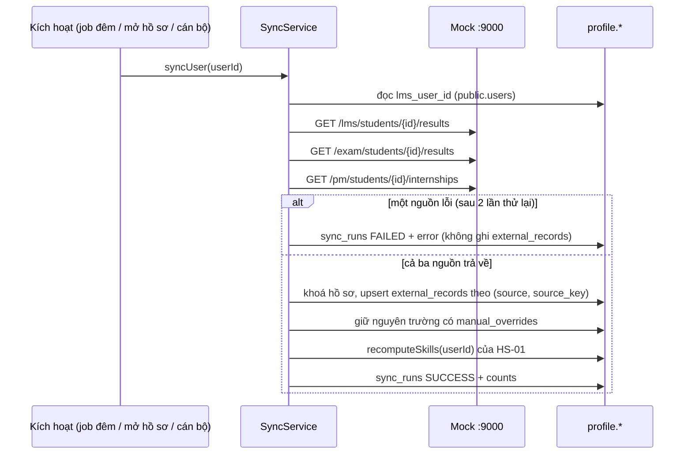
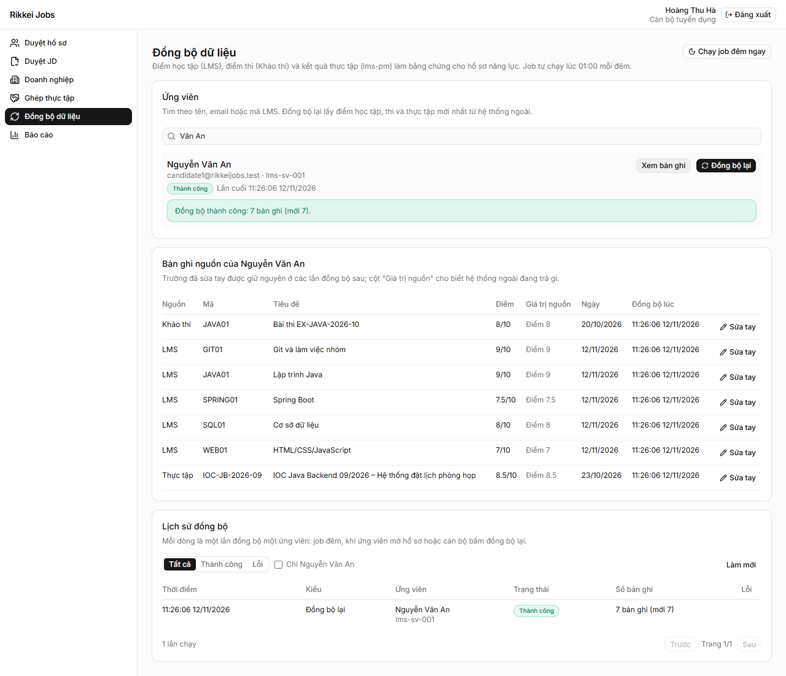
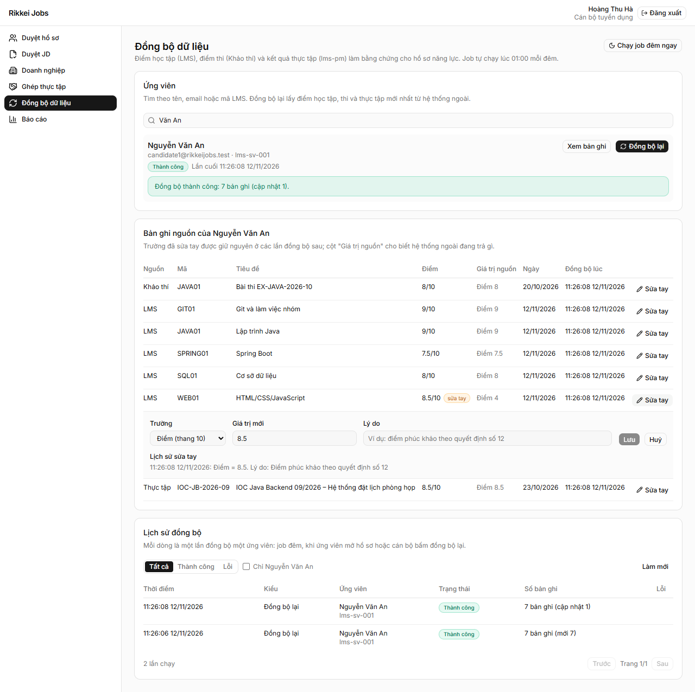
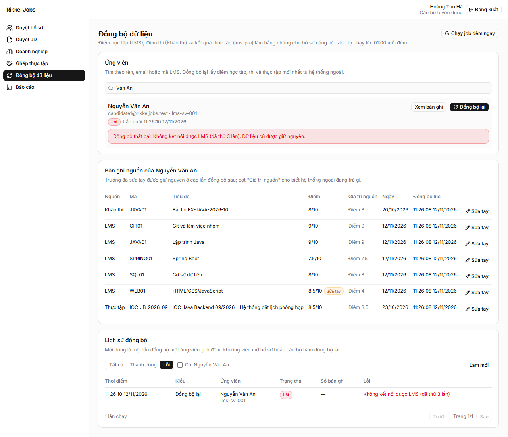
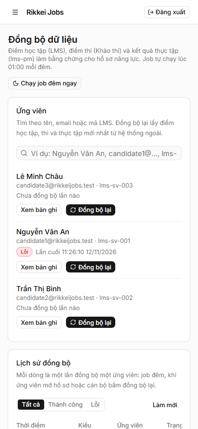
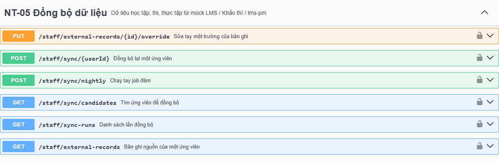

# NT-05 · Đồng bộ dữ liệu học tập, thi, thực tập

| Mục | Giá trị |
| --- | --- |
| Mã task | T023175 |
| Sprint | Sprint 2 (ngày 15), hạn 20/11/2026 |
| Nhánh | `feature/t023175-JOBS-NT-05-dong-bo-du-lieu` |
| Backend | `profile-service` (bảng, client gọi mock, đồng bộ, job đêm, API STAFF), `api-gateway` (route `/staff/sync…`, `/staff/external-records…`) |
| Frontend | `web/src/app/(pages)/(app)/staff/sync`, `web/src/app/components/sync/*`, mục menu STAFF "Đồng bộ dữ liệu" |
| Phụ thuộc | Mock hệ thống ngoài (`mock/`), NT-01 (`users.lms_user_id`), NT-02 (phân quyền, Swagger), HS-01 (`external_records`, `recomputeSkills`) |

## 1. Mục tiêu

Kéo dữ liệu học tập (LMS), điểm thi (Khảo thí) và kết quả thực tập (lms-pm) của ứng viên từ **mock** về database.
Dữ liệu này làm nguồn bằng chứng cho hồ sơ năng lực HS-01. Task chỉ gọi mock, không gọi hệ thống thật.

## 2. Luồng xử lý



- **Lấy đủ rồi mới ghi.** Cả ba nguồn trả về thì mới ghi, trong một transaction. Một nguồn lỗi thì lần chạy là `FAILED`, `external_records` giữ nguyên.
- **Không trùng.** Bản ghi được upsert theo `source_key = "<lmsUserId>:<mã>"`, có ràng buộc `UNIQUE (source, source_key)`. Đồng bộ nhiều lần chỉ cập nhật, không thêm dòng.
- **Sửa tay thắng đồng bộ.** Trường có trong `manual_overrides` (`score`, `title`) không bị ghi đè. Các trường khác và `payload` vẫn cập nhật, để cán bộ thấy nguồn đang trả gì.
- **Chạy lần lượt theo ứng viên.** Mỗi lần ghi khoá dòng `skill_profile_states` của ứng viên. Nhờ vậy "Đồng bộ lại" và đồng bộ nền của cùng một người không ghi chồng lên nhau.

### Client gọi mock (`ExternalSourceClient`)

| Yêu cầu | Cách làm |
| --- | --- |
| Header `X-Service-Key` | Lấy từ `LMS_SERVICE_KEY` (mặc định `dev-key`) |
| Timeout 5 giây | Timeout kết nối và đọc đều là 5 giây (`app.sync.timeout`) |
| Thử lại 2 lần | Gọi tối đa 3 lần khi lỗi mạng hoặc 5xx, cách nhau 500 ms. Lỗi 4xx (sai khoá, không có) không thử lại |
| Thông báo lỗi | Câu tiếng Việt, ghi vào `sync_runs.error`, ví dụ `Không kết nối được LMS (đã thử 3 lần)`, `lms-pm trả lỗi HTTP 500 (đã thử 3 lần)` |

### Ba cách kích hoạt

| Kiểu (`trigger`) | Khi nào | Ghi chú |
| --- | --- | --- |
| `NIGHTLY` | 01:00 mỗi đêm (giờ Việt Nam), cho mọi ứng viên `ACTIVE` đã có `lms_user_id` | Cấu hình bằng `SYNC_NIGHTLY_CRON` (cron Spring 6 trường), đặt `-` để tắt. Chạy tay: `POST /staff/sync/nightly` |
| `ON_OPEN` | Ứng viên mở hồ sơ (`GET /profiles/me/skills`) mà lần đồng bộ cuối, kể cả lần lỗi, đã quá 1 giờ | Chạy ở luồng nền, trang trả ngay với dữ liệu hiện có. Đang đồng bộ thì không gửi thêm. Tắt bằng `SYNC_ON_OPEN_ENABLED=false` |
| `MANUAL` | Cán bộ bấm "Đồng bộ lại" (`POST /staff/sync/{userId}`) | Trả kết quả ngay. `triggered_by` lưu id cán bộ |

## 3. Ánh xạ bản ghi sang bằng chứng HS-01

NT-05 ghi vào bảng `external_records` mà HS-01 đã có, rồi gọi `SkillProfileService.recomputeSkills(userId)`. HS-01
đọc các bản ghi `verified = true`, chuẩn hoá điểm về thang 100 (`score * 100 / score_max`) và nhân trọng số trong
`skill_mappings` theo `(source, source_code)`.

| Nguồn | Mỗi bản ghi là | `source_key` | `source_code` | `score` / `score_max` | `recorded_at` |
| --- | --- | --- | --- | --- | --- |
| LMS | một môn | `lms-sv-001:JAVA01` | `subjectCode` | `score` / 10 | Lần đầu đồng bộ (LMS không có ngày); cập nhật khi điểm đổi |
| EXAM | một bài thi | `lms-sv-001:EX-JAVA-2026-10` | `subjectCode` | `score` / 10 | `takenAt` |
| PM | một đợt thực tập | `lms-sv-001:IOC-JB-2026-09` | `batchId` | `finalScore` / 10 | Lần nghiệm thu task cuối (`acceptedAt`), không có thì `endDate` |

- `attendanceRate`, `homeworkRate`, `rpoint` không phải điểm môn học nên chỉ nằm trong `payload` (theo HS-01).
- Bản ghi bị bỏ qua và đếm vào `counts.skipped` khi: thiếu mã, điểm ngoài thang 0–10, ngày sai định dạng, hoặc đợt thực tập chưa có `finalScore` (chưa chốt).
- Mock không có mã kỹ năng cho đợt thực tập. Vì vậy `V4__nt05_external_sync.sql` thêm ánh xạ mẫu `PM / IOC-JB-2026-09`, `IOC-JB-2026-12` → REST API (0.6), Spring Boot (0.4).
- **Cần chủ HS-01 xác nhận:** ánh xạ đợt thực tập → kỹ năng và trọng số; dùng `finalScore` của đợt hay điểm từng task.

## 4. Cơ sở dữ liệu

Migration `profile-service/src/main/resources/db/migration/V4__nt05_external_sync.sql` (schema `profile`). Sơ đồ: [ERD](../database/erd.md).

| Bảng | Cột chính | Ghi chú |
| --- | --- | --- |
| `external_records` (HS-01, thêm cột) | `source_key`, `payload JSONB`, `synced_at` | `UNIQUE (source, source_key)`. Bản ghi HS-01 nạp tay có `source_key` NULL |
| `manual_overrides` | `record_id` FK, `field` (`score` \| `title`), `value`, `reason`, `staff_id`, `created_at` | Giữ cả lịch sử; trường đã có dòng ở đây thì đồng bộ không ghi đè |
| `sync_runs` | `trigger`, `user_id` (NULL được), `status`, `started_at`, `finished_at`, `error`, `counts JSONB`, `triggered_by` | `status = FAILED` thì bắt buộc có `error`. `user_id` NULL khi job đêm lỗi trước khi tới được ứng viên nào |

`counts` gồm `fetched` (số phần tử ba nguồn trả), `inserted`, `updated`, `unchanged`, `skipped`.

## 5. API (STAFF)

Mọi endpoint yêu cầu vai trò `STAFF`; vai trò khác nhận `403`, thiếu token nhận `401`. Xem và thử tại Swagger UI
`http://localhost:8080/api/docs`, chọn **profile-service**, nhóm **NT-05 Đồng bộ dữ liệu**.

| Method | Đường dẫn (sau `/api/v1`) | Mô tả |
| --- | --- | --- |
| `POST` | `/staff/sync/{userId}` | Đồng bộ lại một ứng viên. Mock lỗi vẫn trả `200` với `status: "FAILED"` và `error`. Ứng viên không tồn tại: `404`; chưa liên kết LMS: `400` |
| `POST` | `/staff/sync/nightly` | Chạy tay job đêm ở luồng nền, trả `202`. Đang chạy thì `409` |
| `GET` | `/staff/sync-runs?status=&userId=&page=1&size=20` | Lần đồng bộ, mới nhất trước. `status` là `SUCCESS` hoặc `FAILED`. Phân trang theo [quy ước](../conventions.md) |
| `GET` | `/staff/sync/candidates?q=` | Tìm ứng viên theo tên, email, mã LMS (tối đa 20), kèm lần đồng bộ cuối |
| `GET` | `/staff/external-records?userId=` | Bản ghi nguồn kèm `payload`, `overriddenFields`, lịch sử sửa tay |
| `PUT` | `/staff/external-records/{id}/override` | Body `{field, value, reason}`. `field` là `score` (0 đến `scoreMax`, tối đa 2 chữ số thập phân) hoặc `title`. Sai thì `400 VALIDATION_ERROR` kèm `errors.<trường>` |

Ví dụ kết quả một lần đồng bộ lỗi:

```json
{
  "id": "…", "trigger": "MANUAL", "userId": "…", "candidateName": "Nguyễn Văn An", "lmsUserId": "lms-sv-001",
  "status": "FAILED", "startedAt": "2026-11-12T04:26:10.101Z", "finishedAt": "2026-11-12T04:26:11.640Z",
  "error": "Không kết nối được LMS (đã thử 3 lần)", "counts": null, "triggeredBy": "…"
}
```

## 6. Cách chạy

Cần: Postgres, mock, identity-service (profile `dev`, có tài khoản mẫu và `lms_user_id`), profile-service, gateway, web.

```sh
# 1. Postgres
docker compose --env-file .env -f infra/compose.yaml up -d postgres
# 2. Mock (terminal riêng)
cd mock && npm ci && npm start                      # :9000
# 3. Backend (terminal riêng cho mỗi lệnh run)
mvn -f server/pom.xml install -DskipTests
mvn -f server/services/identity-service/pom.xml spring-boot:run "-Dspring-boot.run.profiles=dev"   # :8081, seed tài khoản mẫu
mvn -f server/services/profile-service/pom.xml spring-boot:run "-Dspring-boot.run.profiles=dev"    # :8082, migrate V4
mvn -f server/api-gateway/pom.xml spring-boot:run                                                  # :8080
# 4. Web
cd web && npm run dev -- --port 3000
```

Đăng nhập `http://localhost:3000/login`, tab **Qua LMS**, chọn tài khoản mẫu `staff1` (Hoàng Thu Hà, `lms-st-001`; cần `NEXT_PUBLIC_LMS_MOCK=true` như hướng dẫn NT-01), rồi vào menu **Đồng bộ dữ liệu** (`/staff/sync`).

Biến môi trường của profile-service:

| Biến | Mặc định | Ý nghĩa |
| --- | --- | --- |
| `LMS_BASE_URL` | `http://localhost:9000` | Địa chỉ mock (dùng chung với identity-service) |
| `LMS_SERVICE_KEY` | `dev-key` | Giá trị `X-Service-Key` |
| `SYNC_NIGHTLY_CRON` | `0 0 1 * * *` | Giờ chạy job đêm (giây phút giờ ngày tháng thứ); `-` để tắt |
| `SYNC_ZONE` | `Asia/Ho_Chi_Minh` | Múi giờ của lịch job |
| `SYNC_ON_OPEN_ENABLED` | `true` | Đồng bộ nền khi ứng viên mở hồ sơ |

Dữ liệu demo của HS-01 (`PROFILE_DEMO_DATA_ENABLED=true`) nạp bản ghi mẫu `c1-java-final`… không có `source_key`.
Chúng sẽ cộng thêm vào bản ghi đồng bộ từ mock. Muốn xem đúng dữ liệu NT-05 thì để biến này `false` (mặc định).

### Chạy tay job đêm (cho mentor thử)

Cách 1, trên giao diện: đăng nhập STAFF, vào **Đồng bộ dữ liệu**, bấm **Chạy job đêm ngay**, rồi bấm **Làm mới** ở bảng "Lịch sử đồng bộ". Mỗi ứng viên có một dòng kiểu "Job đêm".

Cách 2, qua API:

```sh
curl -X POST http://localhost:8080/api/v1/staff/sync/nightly -H "Authorization: Bearer <token STAFF>"
# 202 {"message":"Đã bắt đầu đồng bộ toàn bộ ứng viên"}
curl "http://localhost:8080/api/v1/staff/sync-runs?size=5" -H "Authorization: Bearer <token STAFF>"
```

Cách 3, đổi giờ chạy: khởi động profile-service với `SYNC_NIGHTLY_CRON="0 */2 * * * *"`. Job sẽ chạy mỗi 2 phút.

Lấy token STAFF: `POST /api/v1/auth/dev/sso-ticket` với `{"lmsUserId":"lms-st-001"}`, rồi `POST /api/v1/auth/sso` với `{"ticket":"…"}`.

## 7. Dữ liệu mẫu

- **Ứng viên:** `candidate1` (`lms-sv-001`), `candidate2` (`lms-sv-002`), `candidate3` (`lms-sv-003`) do NT-01 seed. Cán bộ: `staff1` (`lms-st-001`).
- **Dữ liệu nguồn:** `mock/data.json`. Ví dụ `candidate1` có 5 môn LMS, 1 bài thi Java, 1 đợt thực tập IOC-JB-2026-09; đồng bộ lần đầu được 7 bản ghi.
- **Đổi điểm để thử:** sửa `lmsResults["lms-sv-001"]` trong `mock/data.json` rồi gọi `POST http://localhost:9000/mock/reload`. Không cần khởi động lại mock.

## 8. Kịch bản nghiệm thu

| Tiêu chí | Cách thử | Kết quả mong đợi |
| --- | --- | --- |
| Đổi điểm trong mock → Đồng bộ lại có điểm mới | Sửa điểm `JAVA01` của `lms-sv-001` thành `9`, `/mock/reload`, bấm **Đồng bộ lại** ở Nguyễn Văn An | Thông báo "Đồng bộ thành công: 7 bản ghi (cập nhật 1)". Bảng bản ghi hiện `9/10`. `external_records.score = 9` |
| Tắt mock → FAILED, hiện lỗi, dữ liệu cũ còn | `Ctrl + C` ở terminal mock, bấm **Đồng bộ lại** | Báo đỏ "Đồng bộ thất bại: Không kết nối được LMS (đã thử 3 lần). Dữ liệu cũ được giữ nguyên." Lọc **Lỗi** ở bảng lịch sử thấy dòng FAILED kèm lỗi. Bản ghi không đổi |
| Sửa tay không bị ghi đè | **Sửa tay** dòng `WEB01`: Điểm = `8.5`, nhập lý do, **Lưu**. Đổi `WEB01` trong mock thành `4`, reload, **Đồng bộ lại** | Điểm vẫn `8.5/10` có nhãn "sửa tay"; cột "Giá trị nguồn" hiện `Điểm 4`. Lịch sử sửa tay có lý do |
| Đồng bộ 2 lần không trùng | Bấm **Đồng bộ lại** hai lần | Lần 2: "7 bản ghi" không có "mới". `select count(*) from profile.external_records` không tăng |
| Job đêm có cấu hình giờ chạy | Xem `SYNC_NIGHTLY_CRON` và mục "Chạy tay job đêm" ở trên | Mỗi ứng viên có một dòng "Job đêm" |
| OpenAPI có endpoint mới | `http://localhost:8080/api/docs` → profile-service | Nhóm "NT-05 Đồng bộ dữ liệu" có 6 endpoint |

Test tự động (H2, HTTP server giả lập mock, không cần Docker):

```sh
mvn -f server/pom.xml -pl services/profile-service,api-gateway -am test -Dtest='ExternalSyncApiTest,ExternalSourceClientTest,ProfileSyncRouteIntegrationTest' -Dsurefire.failIfNoSpecifiedTests=false
```

- `ExternalSyncApiTest` (16 ca) kiểm từng tiêu chí ở bảng trên qua API thật. Ngoài ra còn kiểm: một nguồn lỗi thì không ghi gì, bỏ qua bản ghi sai, phân quyền, phân trang, tìm ứng viên, đồng bộ nền khi mở hồ sơ, và job đêm (một ứng viên lỗi không làm hỏng ứng viên khác).
- `ExternalSourceClientTest` (6 ca) kiểm `X-Service-Key`, mock tắt (gọi 3 lần rồi báo lỗi), 5xx thử lại, 4xx không thử lại, và timeout.

## 9. Ảnh màn hình

Đồng bộ lại sau khi đổi điểm trong mock (JAVA01 lên 9):



Sửa tay điểm WEB01 = 8.5; mock trả 4 nhưng đồng bộ lại vẫn giữ 8.5:



Tắt mock rồi đồng bộ: báo lỗi, bảng lịch sử lọc "Lỗi", bản ghi giữ nguyên:



Màn hình hẹp và Swagger:




