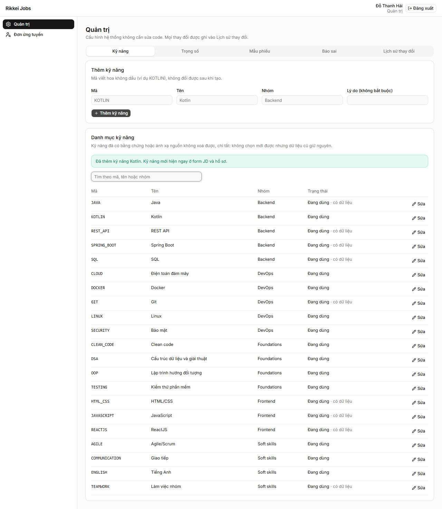
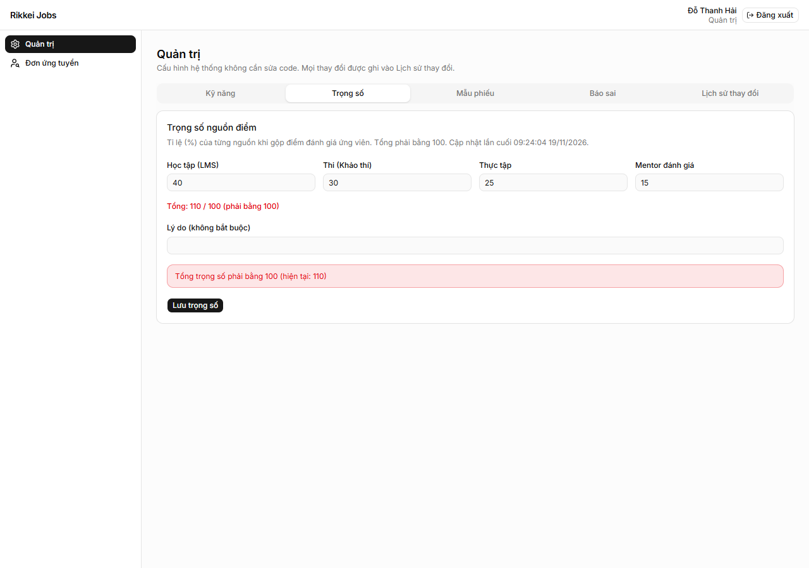
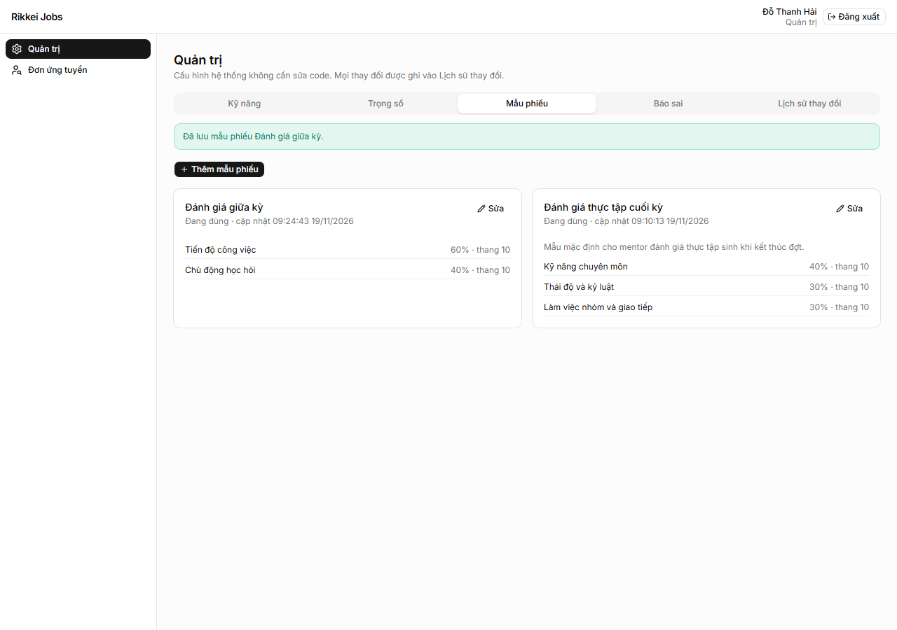
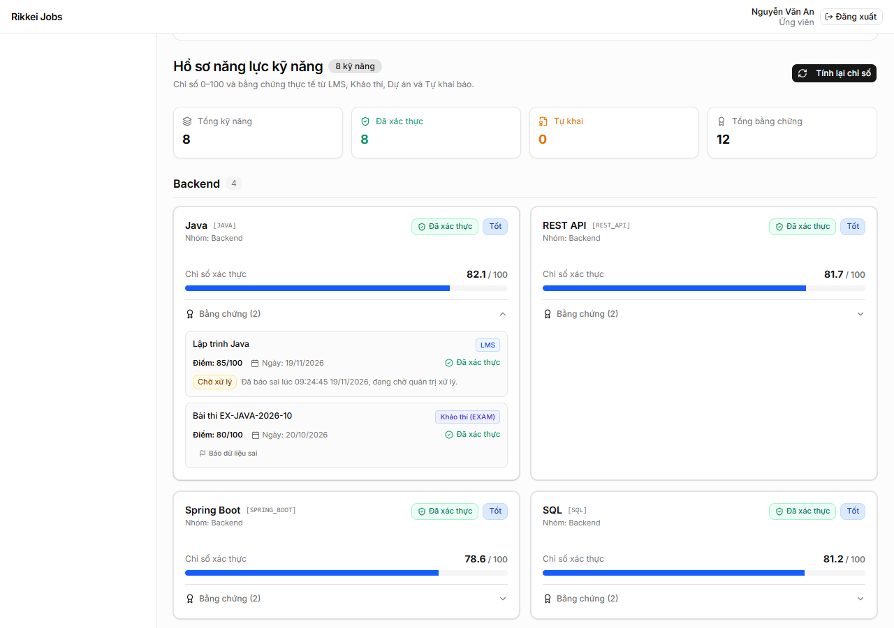
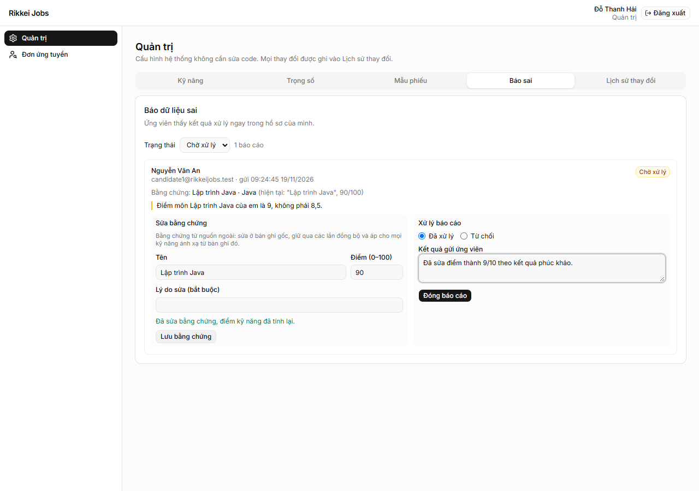
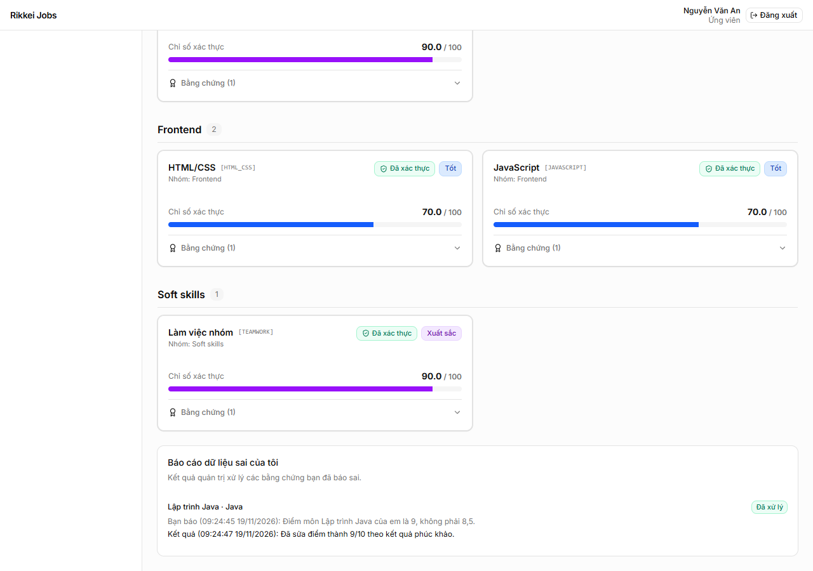
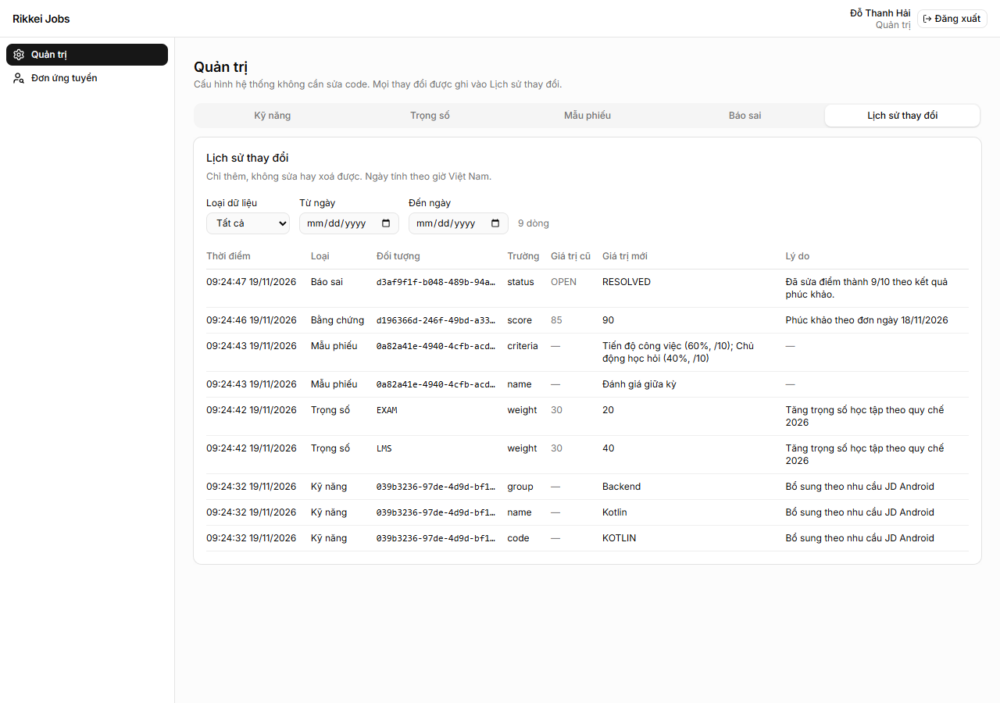
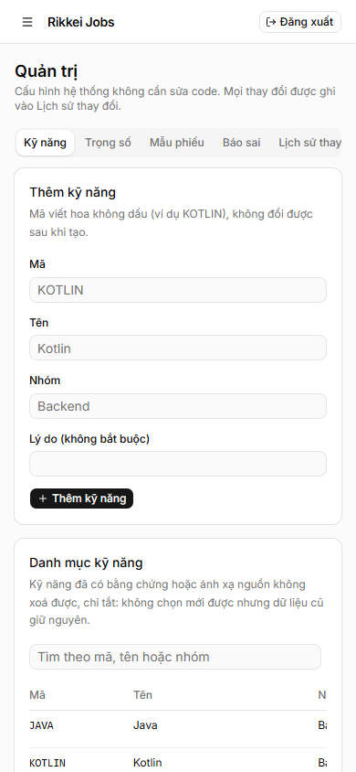
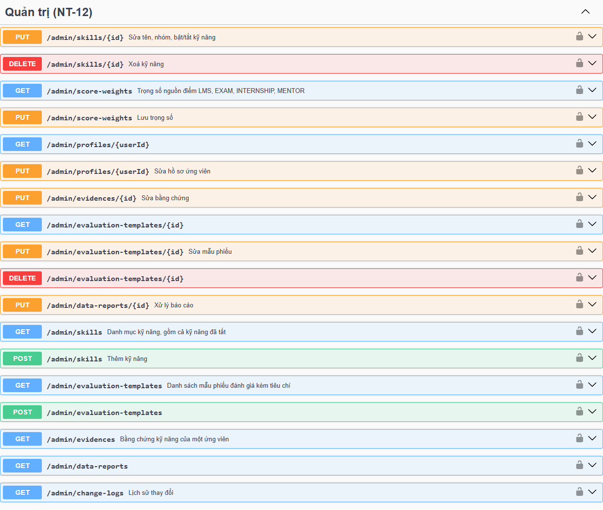

# NT-12 · Quản trị: danh mục kỹ năng, trọng số, mẫu phiếu, nhật ký

| Mục | Giá trị |
| --- | --- |
| Mã task | T023304 |
| Nhánh | `feature/NT-12-quan-tri-he-thong` |
| Backend | `profile-service` (bảng, API `/admin/*`, `/me/data-reports`, `/score-weights`, `/evaluation-templates`), `common-core` (chặn `/admin/**` cho ADMIN ở tầng URL), `api-gateway` (route mới) |
| Frontend | `web/src/app/(pages)/(app)/admin/settings`, `web/src/app/components/admin/*`, nút "Báo dữ liệu sai" ở `web/src/app/components/skills/*` |
| Phụ thuộc | HS-01 (`skills`, `skill_evidences`), NT-05 (sửa tay bản ghi nguồn), DG-01, DG-03 (xem mục 3) |

## 1. Mục tiêu

ADMIN cấu hình hệ thống mà không cần sửa code. Mọi lần sửa dữ liệu đều có lý do và lịch sử.

- **Danh mục kỹ năng.** Thêm, sửa tên và nhóm, bật/tắt. Kỹ năng đã có dữ liệu (bằng chứng, điểm hoặc ánh xạ nguồn) không xoá cứng được, chỉ tắt. Kỹ năng tắt không chọn mới được ở form JD và ở phần kỹ năng tự khai, nhưng bằng chứng và điểm cũ vẫn giữ nguyên và vẫn hiện trên hồ sơ.
- **Trọng số nguồn điểm.** Gồm LMS, EXAM, INTERNSHIP, MENTOR. Phải gửi đủ 4 nguồn và tổng đúng bằng 100.
- **Mẫu phiếu đánh giá.** Mỗi mẫu kèm danh sách tiêu chí (tên, mô tả, trọng số %, thang điểm, thứ tự).
- **Sửa hồ sơ, sửa bằng chứng.** Bắt buộc nhập lý do. Mỗi trường thay đổi ghi một dòng `change_logs` gồm giá trị cũ và mới.
- **Báo dữ liệu sai.** Ứng viên báo một bằng chứng sai. ADMIN xem, sửa bằng chứng nếu cần, rồi đóng báo cáo kèm kết quả. Ứng viên thấy kết quả ngay trong hồ sơ.
- **Lịch sử thay đổi.** Lọc theo loại dữ liệu và khoảng ngày.

## 2. Cơ sở dữ liệu (`V9__nt12_admin.sql`, schema `profile`)

| Bảng | Ghi chú |
| --- | --- |
| `skills.active` | Cột mới, mặc định `TRUE`. |
| `score_weights(source PK, weight, updated_by, updated_at)` | Seed: LMS 30, EXAM 30, INTERNSHIP 25, MENTOR 15. CHECK chặn từng giá trị ngoài 0–100. Ràng buộc tổng bằng 100 kiểm ở API. |
| `evaluation_templates`, `evaluation_criteria` | Tên mẫu là duy nhất. Xoá mẫu thì xoá theo các tiêu chí. Seed mẫu "Đánh giá thực tập cuối kỳ" với 3 tiêu chí 40/30/30. |
| `change_logs(id, entity, entity_id, field, old_value, new_value, reason, admin_id, created_at)` | Chỉ thêm. `entity_id` kiểu text để ghi được cả khoá không phải UUID (ví dụ `LMS`). |
| `data_reports(id, user_id, evidence_id, evidence_title, skill_name, content, status, resolution, resolved_by, resolved_at, created_at)` | Nếu bằng chứng bị xoá (nguồn ngoài không còn bản ghi) thì `evidence_id` thành `NULL`, tên vẫn giữ ở `evidence_title`. CHECK: báo cáo đã đóng phải có `resolution`, `resolved_by`, `resolved_at`. |

Sơ đồ quan hệ: [docs/database/erd.md](../database/erd.md).

## 3. Dùng chung với DG-01, DG-03

DG-01 và DG-03 chưa có trên `test`, nên NT-12 tạo trước các bảng `score_weights`, `evaluation_templates`, `evaluation_criteria`. Ba quy ước khi hai task này làm tiếp:

1. **Đọc qua API, không đọc thẳng bảng.** Các bảng nằm trong schema `profile` của profile-service. Service khác gọi:
   - `GET /api/v1/score-weights`: trọng số hiện hành.
   - `GET /api/v1/evaluation-templates`: các mẫu phiếu đang bật kèm tiêu chí.

   Vai trò được gọi: MENTOR, STAFF, ADMIN.
2. **Mở rộng bằng migration mới.** Cần thêm cột thì viết `ALTER TABLE` trong một migration mới của profile-service, không `CREATE` lại bảng.
3. **Phiếu đã chấm giữ bản chụp tiêu chí.** Phiếu đánh giá của DG-01 lưu `template_id` kèm bản chụp tiêu chí lúc chấm. ADMIN sửa mẫu là thay toàn bộ tiêu chí, nên phiếu cũ không được phụ thuộc vào mẫu hiện tại.

Trọng số mới được lưu và mở API đọc. Việc gộp điểm theo trọng số là phần của DG-03. NT-12 không đổi cách HS-01 tính điểm kỹ năng.

## 4. API

Qua gateway, có tiền tố `/api/v1`. Mọi `/admin/*` chỉ ADMIN được gọi. Vai trò khác nhận **403**, kể cả khi body sai định dạng: chặn ở tầng URL trong `common-core`, trước khi đọc body. Không có token thì nhận 401.

| Method | Đường dẫn | Ghi chú |
| --- | --- | --- |
| GET | `/admin/skills` | Gồm cả kỹ năng đã tắt. `inUse=true` nghĩa là đã có dữ liệu. |
| POST | `/admin/skills` | `{code, name, group, reason?}`. Mã được viết hoa; trùng mã trả 409. |
| PUT | `/admin/skills/{id}` | `{name, group, active, reason?}`. Mã không đổi được. |
| DELETE | `/admin/skills/{id}?reason=` | Đã có dữ liệu thì trả `{deleted:false, deactivated:true}`; chưa có thì xoá hẳn. |
| GET | `/admin/score-weights` | |
| PUT | `/admin/score-weights` | `{weights:[{source, weight}], reason?}`. Tổng khác 100 trả 400 `VALIDATION_ERROR`, `errors.weights`. |
| GET, POST | `/admin/evaluation-templates` | Body `{name, description?, active?, criteria:[{name, description?, weight, maxScore}], reason?}`. Tối thiểu 1 tiêu chí, tối đa 50. |
| GET, PUT, DELETE | `/admin/evaluation-templates/{id}` | PUT thay toàn bộ tiêu chí. |
| GET, PUT | `/admin/profiles/{userId}` | PUT gồm các trường hồ sơ HS-02 kèm **`reason` bắt buộc**. Chỉ ghi nhật ký những trường thực sự đổi. |
| GET | `/admin/evidences?userId=` | Bằng chứng kỹ năng của một ứng viên. |
| PUT | `/admin/evidences/{id}` | `{score?, title?, reason}`, **`reason` bắt buộc**, `score` thang 0–100. Bằng chứng tự khai không sửa được (400). |
| GET | `/admin/data-reports?status=&page=&size=` | Kèm tên, email ứng viên và bằng chứng hiện tại. |
| PUT | `/admin/data-reports/{id}` | `{status: RESOLVED\|REJECTED, resolution}`. Báo cáo đã đóng thì trả 409. |
| GET | `/admin/change-logs?entity=&entityId=&from=&to=&page=&size=` | `from`, `to` dạng `yyyy-MM-dd`, tính theo giờ Việt Nam, gồm cả ngày `to`. |
| POST | `/me/data-reports` | Chỉ CANDIDATE. `{evidenceId, content}`. Bằng chứng của người khác trả 404. Mỗi bằng chứng chỉ có một báo cáo đang chờ (409). |
| GET | `/me/data-reports` | Báo cáo của tôi kèm kết quả. |
| GET | `/score-weights`, `/evaluation-templates` | MENTOR, STAFF, ADMIN. Dành cho DG-03 và DG-01. |

**Sửa bằng chứng từ nguồn ngoài.** Bằng chứng sinh từ bản ghi đồng bộ (NT-05) được sửa ở bản ghi gốc, dùng cơ chế sửa tay của NT-05 (`manual_overrides`). Nhờ vậy lần đồng bộ sau không ghi đè. Điểm 0–100 được đổi sang thang của nguồn và làm tròn 2 chữ số thập phân. Một bản ghi gốc có thể ánh xạ sang nhiều kỹ năng (ví dụ JAVA01 sang Java 70% và SQL 30%), nên sửa ở đây đổi mọi bằng chứng sinh từ bản ghi đó.

**Thay đổi API HS-01 (chỉ thêm trường).**
- `GET /skills` và `skill` trong hồ sơ có thêm `active`. Danh mục vẫn trả cả kỹ năng đã tắt, để JD cũ có kỹ năng đó vẫn lưu lại được. Web lọc kỹ năng đã tắt khỏi ô chọn mới.
- Mỗi bằng chứng trong hồ sơ có thêm `id`, dùng để báo sai.
- `PUT /profiles/me/self-skills` từ chối kỹ năng đã tắt nếu ứng viên chưa khai trước đó.

OpenAPI: Swagger UI `http://localhost:8080/api/docs`, chọn **profile-service**, nhóm **Quản trị (NT-12)**, **Báo dữ liệu sai (NT-12)**, **Cấu hình đánh giá (NT-12)**.

## 5. Cách chạy

Giống [NT-05 mục 6](NT-05-dong-bo-du-lieu.md#6-cách-chạy). Cần Postgres, mock, identity-service (profile `dev`), profile-service, company-service (form JD), gateway, web.

```sh
docker compose --env-file .env -f infra/compose.yaml up -d postgres
cd mock && npm ci && npm start                                                                  # :9000
mvn -f server/pom.xml install -DskipTests
mvn -f server/services/identity-service/pom.xml spring-boot:run "-Dspring-boot.run.profiles=dev"   # :8081
mvn -f server/services/profile-service/pom.xml spring-boot:run "-Dspring-boot.run.profiles=dev"    # :8082, migrate tới V9
mvn -f server/services/company-service/pom.xml spring-boot:run "-Dspring-boot.run.profiles=dev"    # :8085
mvn -f server/api-gateway/pom.xml spring-boot:run                                                  # :8080
cd web && npm run dev -- --port 3000
```

Đăng nhập `http://localhost:3000/login`, tab **Qua LMS**, rồi chọn tài khoản theo vai trò:

| Vai trò | Tài khoản | Việc thử |
| --- | --- | --- |
| ADMIN | `admin1`, `lms-ad-001` | Menu **Quản trị** (`/admin/settings`) |
| Ứng viên | `candidate1`, `lms-sv-001` | **Hồ sơ**: mở một kỹ năng, mục Bằng chứng, nút **Báo dữ liệu sai** |
| HR | `hr1@rikkeijobs.test` / `Test@123`, tab Doanh nghiệp | Kiểm tra kỹ năng mới ở form JD (`/hr/jobs/new`, bước **Kỹ năng yêu cầu**) |

Ứng viên cần có bằng chứng: lần đầu mở hồ sơ, hệ thống tự đồng bộ từ mock (NT-05). Cũng có thể dùng STAFF (`lms-st-001`), vào **Đồng bộ dữ liệu**, bấm **Đồng bộ lại** cho `candidate1`.

Request mẫu: [NT-12.http](NT-12.http).

## 6. Dữ liệu mẫu

- **Trọng số:** LMS 30, EXAM 30, INTERNSHIP 25, MENTOR 15 (tổng 100).
- **Mẫu phiếu "Đánh giá thực tập cuối kỳ":** Kỹ năng chuyên môn 40%, Thái độ và kỷ luật 30%, Làm việc nhóm và giao tiếp 30%, cùng thang 10.
- **Kỹ năng:** 20 kỹ năng của HS-01, tất cả đang bật.
- **Bằng chứng để thử báo sai và sửa:** `candidate1` sau khi đồng bộ có môn "Lập trình Java" 8,5/10, tức 85/100 ở kỹ năng Java.

## 7. Kịch bản nghiệm thu

| Tiêu chí | Cách kiểm | Kết quả |
| --- | --- | --- |
| Thêm kỹ năng mới thì xuất hiện ở form JD và hồ sơ | ADMIN thêm `KOTLIN`. HR mở `/hr/jobs/new`, bước Kỹ năng, gõ "Kotlin". Ứng viên thấy Kotlin ở ô chọn kỹ năng tự khai. | Đạt |
| Lưu trọng số có tổng khác 100 thì báo lỗi | Đổi LMS thành 40 (tổng 110), bấm Lưu: hiện "Tổng trọng số phải bằng 100 (hiện tại: 110)". | Đạt |
| Sửa bằng chứng không nhập lý do thì bị chặn; có lý do thì `change_logs` ghi giá trị cũ và mới | Ở tab Báo sai, sửa điểm 85 thành 90 không lý do: hiện "Phải nhập lý do sửa". Nhập lý do thì lưu được, và Lịch sử thay đổi có dòng `score` 85 → 90 kèm lý do. | Đạt |
| Ứng viên báo sai thì admin thấy; xử lý xong ứng viên thấy kết quả | Ứng viên bấm **Báo dữ liệu sai**. ADMIN thấy báo cáo ở tab Báo sai, bấm **Đóng báo cáo**. Ứng viên thấy "Đã xử lý" kèm kết quả. | Đạt |
| Tắt kỹ năng đã có bằng chứng thì dữ liệu cũ còn nguyên | ADMIN bấm **Tắt (đã có dữ liệu)** cho JAVA. Hồ sơ ứng viên vẫn còn kỹ năng Java với bằng chứng và điểm cũ. | Đạt |
| Token không phải ADMIN gọi `/admin/*` thì nhận 403 | API với token CANDIDATE, HR, MENTOR, STAFF đều trả 403. STAFF mở `/admin/settings` thì thấy trang 403. | Đạt |

Test tự động:
- `AdminApiTest`: 13 ca, gồm 6 tiêu chí trên cùng mẫu phiếu, nhật ký, sửa hồ sơ, và sửa bằng chứng từ nguồn ngoài giữ được qua lần tính lại.
- `ProfileAdminRouteIntegrationTest` ở gateway: 12 ca.

Lệnh chạy:

```sh
mvn -f server/pom.xml -pl services/profile-service,api-gateway -am test
```

## 8. Ảnh màn hình

| Màn | Ảnh |
| --- | --- |
| Tab Kỹ năng |  |
| Trọng số tổng khác 100 |  |
| Mẫu phiếu |  |
| Ứng viên báo dữ liệu sai |  |
| ADMIN xử lý báo sai, sửa bằng chứng |  |
| Ứng viên thấy kết quả |  |
| Lịch sử thay đổi |  |
| Màn hình hẹp |  |
| OpenAPI (Swagger) |  |
