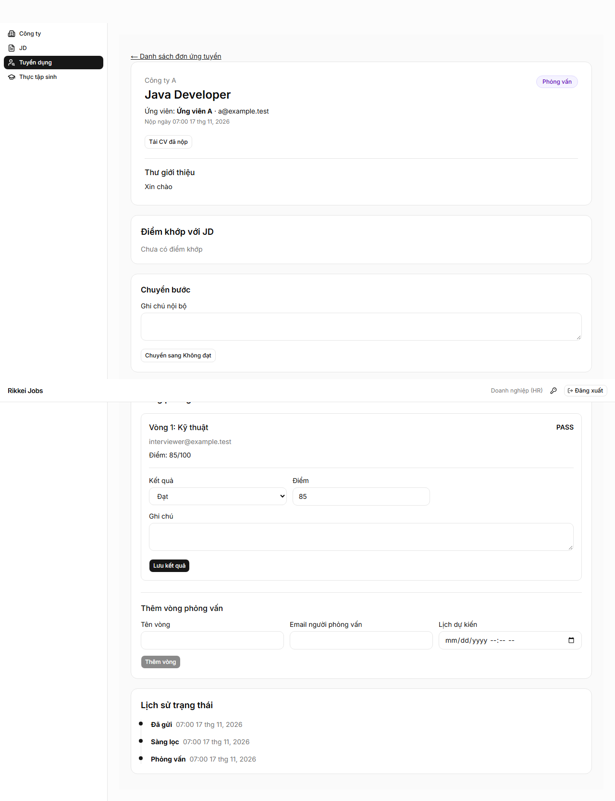
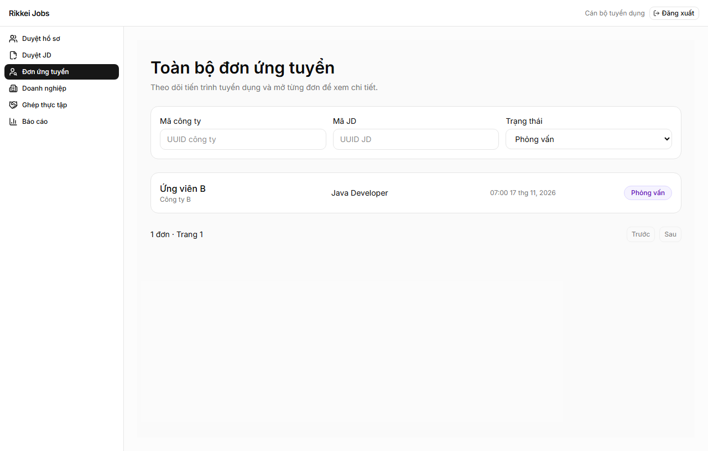
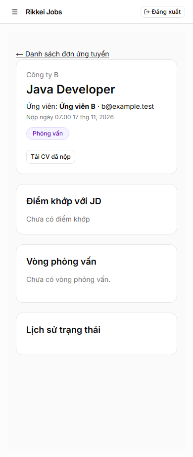

# UT-02 — HR xử lý đơn và STAFF theo dõi

## Chạy thử

Yêu cầu JDK 21, Maven 3.9+, Node theo `web/package.json`, PostgreSQL và các service identity, company, profile. Từ root repo:

```powershell
Copy-Item .env.example .env
docker compose --env-file .env up -d postgres mailhog mock identity-service company-service profile-service recruitment-service api-gateway
npm ci --prefix web
npm --prefix web run dev
```

Mở `/hr/recruitment` bằng HR của công ty A, `/staff/applications` bằng STAFF. MailHog hiển thị email ở cổng cấu hình trong `infra/compose.yaml`. API qua gateway dùng `/api/v1/recruitment`; [OpenAPI UT-02](ut02-openapi.yaml) mô tả request, response và lỗi. Swagger UI của service ở `/api/docs`.

UT-01 cần JD/CV thật hoặc mock contract của [UT-01](UT-01-applications.md). `MATCH_SERVICE_URL` trỏ tới owner DN-06, mặc định company-service; nếu DN-06 chưa có hoặc trả 404/503 thì chi tiết hiển thị `match:null`. Không tính điểm từ PDF. `IDENTITY_SERVICE_URL` và `RECRUITMENT_IDENTITY_SERVICE_KEY` dùng để lấy tên, email ứng viên hiện hành qua `/internal/users/{id}` hoặc batch `/internal/users/candidates/lookup`. Trong Compose, các URL và key đã nối giữa service. Nếu owner DN-06 đặt endpoint ở prefix khác, cập nhật `MATCH_SERVICE_URL` khi tích hợp.

## Quyền và luật

| Vai trò | Xem danh sách/chi tiết/CV | Chuyển bước, thêm và sửa vòng |
| --- | --- | --- |
| HR | Chỉ đơn có `companyId` bằng JWT; đoán ID công ty khác nhận 404 | Có, chỉ theo `allowedTransitions`; thêm/sửa vòng khi `INTERVIEW` |
| STAFF | Tất cả, lọc company/JD/status | Không, nhận 403 |
| CANDIDATE | Đơn của mình theo API UT-01 | Không; chỉ rút đơn theo luật UT-01 |

DN-05: recruitment-service hỏi trạng thái HR hiện hành qua `POST /internal/users/lookup` trên identity-service ở mỗi request HR. Tài khoản bị cán bộ khoá nhận `401 ACCOUNT_DISABLED` dù JWT còn hạn; identity tạm lỗi nhận 503 để không xử lý bằng trạng thái chưa xác thực. Endpoint tra ứng viên của UT-02 là `/internal/users/candidates/lookup` riêng.

Map HR: `SUBMITTED → SCREENING|REJECTED`, `SCREENING → INTERVIEW|REJECTED`, `INTERVIEW → REJECTED`. Sai cặp nhận `409 INVALID_TRANSITION`. UT-07 sở hữu API gửi offer: core transition chỉ cho `INTERVIEW → OFFER` khi có ít nhất một vòng, không vòng nào `PENDING`, vòng có `roundNo` lớn nhất `PASS`. Vòng cuối `FAIL` hoặc còn `PENDING` nhận 409. Core khoá hàng đơn trước khi kiểm và cập nhật, cũng khoá cùng hàng khi thêm/sửa vòng.

Mỗi transition thành công ghi `application_status_history` và một event `application_status_notification_outbox` trong cùng transaction. Tạo đơn `SUBMITTED` ban đầu chỉ báo HR theo UT-01. Worker tra email mới nhất từ identity khi gửi; nội dung không đưa ghi chú HR vào thư. Mỗi event có Message-ID ổn định và tối đa 5 lần thử. SMTP có tính **at-least-once**: crash sau khi SMTP nhận thư nhưng trước khi đánh dấu `SENT` có thể gửi lại cùng Message-ID. Theo dõi hàng lỗi:

```sql
SELECT id, application_id, status_history_id, attempts
FROM recruitment.application_status_notification_outbox WHERE status = 'FAILED';
```

## Dữ liệu mẫu và ảnh

Playwright fixtures `web/e2e/ut02-hr-workflow.spec.ts` và `web/e2e/ut02-staff-applications.spec.ts` cấp dữ liệu HTTP mô phỏng để demo UI độc lập DN-04/DN-06/HS-04. HR công ty A có đơn `20000000-0000-0000-0000-000000000002` của “Ứng viên A”, JD Java Developer, đi từ SUBMITTED qua SCREENING đến INTERVIEW, tạo vòng “Kỹ thuật” rồi chấm PASS/85. STAFF thấy đơn `20000000-0000-0000-0000-000000000003` của “Ứng viên B” ở INTERVIEW và lọc theo trạng thái. Fixture không ghi DB. Để demo API live, cần ứng viên, JD và CV do các service sở hữu tạo trước; không tự chèn bản ghi cross-service giả.







## Kiểm chứng

```powershell
mvn -f server/pom.xml -pl services/recruitment-service,services/identity-service -am test
npm --prefix web run type-check
npm --prefix web run lint
npm --prefix web run build
Push-Location web
npx playwright install chromium
Pop-Location
$env:NEXT_PUBLIC_CV_API_PATH='/profile/cvs'
$env:NEXT_PUBLIC_JOB_PAGE_PATH='/candidate/jobs'
npm --prefix web run test:e2e -- --workers=4
```

Test recruitment dùng Testcontainers PostgreSQL hoặc một DB kiểm thử **riêng** qua `UT01_TEST_DB_URL`, `UT01_TEST_DB_USER`, `UT01_TEST_DB_PASSWORD`; test xoá bảng recruitment giữa các case. `HrTransitionPolicyTest` phủ ma trận 7×7 status. `HrApplicationApiTest` kiểm 409/404/403 và offer gate; `InterviewRoundServiceTest` cùng test concurrency kiểm vòng/audit/khóa; `ApplicationStatusNotificationTest` kiểm event, gửi và retry; `HrApplicationReadApiTest` kiểm tổng hợp và phân quyền; `ApplicationDependencyClientsTest` kiểm HTTP identity/match. Playwright kiểm HR thao tác vòng và STAFF chỉ đọc; ảnh phía trên được chụp trong test.

Checklist nghiệm thu: SUBMITTED→INTERVIEW 409; HR công ty B xem đơn A 404; STAFF tải CV được; vòng cuối FAIL hoặc PENDING chặn offer; mỗi chuyển bước có một event email; response chi tiết có CV, ứng viên, match hiện hành, vòng và lịch sử; FE chỉ hiện nút theo `allowedTransitions`.

Trước khi merge, một thành viên nhóm review PR `[UT-02]` rồi mentor duyệt. Branch tích hợp cần xác nhận với nhóm vì mô tả task ghi `develop`, trong khi repo hiện dùng `test` và chưa có branch `develop`.
