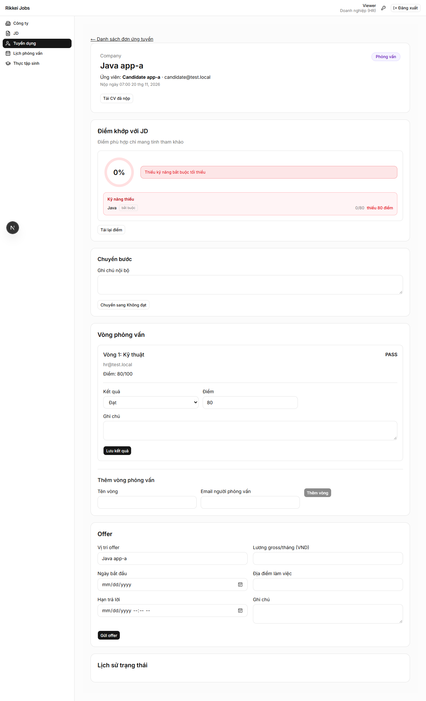
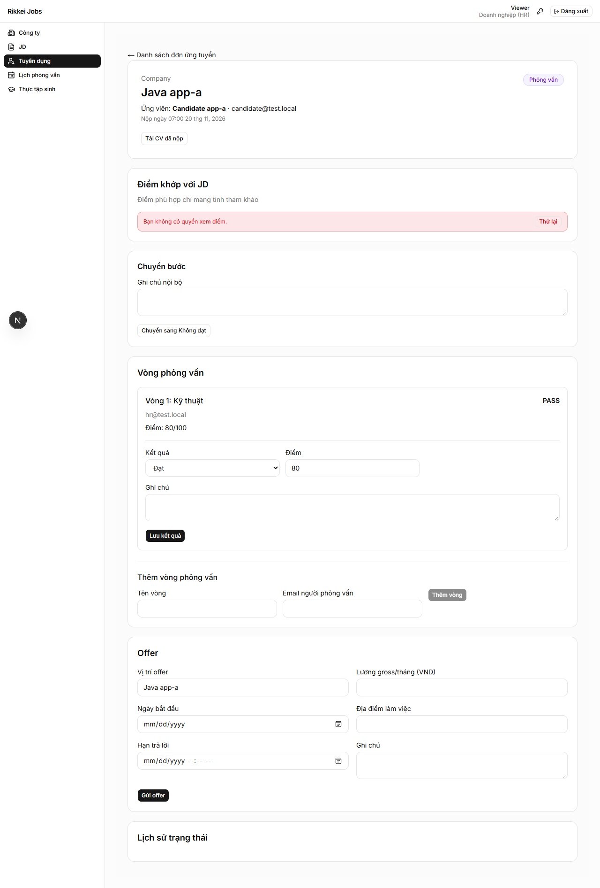
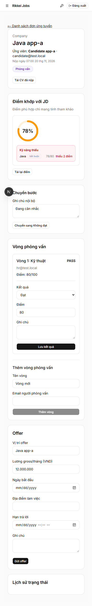

# UT-02/DN-06 — Kiểm chứng điểm tham khảo

Kiểm chứng cục bộ ngày20/11/2026. Base origin/test có UT-06 đã tích hợp; không sửa công thức DN-06, policy tuyển dụng hoặc tạo migration.

| Kiểm tra | Kết quả |
| --- | --- |
| Backend recruitment và dependency modules | 158 tests: recruitment144 + common-core14, 0 failures/errors/skips |
| Browser UT-02 mới và hồi quy UT-02/06/07 | 25/25 trên Chromium |
| Browser riêng luồng matching | 11/11, gồm mobile390px không tràn ngang |
| TypeScript | Pass |
| ESLint | 0 lỗi; warning có sẵn ở commitlint.config.mjs |
| Next production build | Pass |
| OpenAPI | YAML/reference hợp lệ; Ajv kiểm AVAILABLE0, UNAVAILABLE/null, NOT_REQUESTED/null và match nullable trong detail |

Backend chạy PostgreSQL16 riêng, không dùng DB dữ liệu người dùng. Lệnh chính:

```powershell
npm ci --prefix mock
mvn -f server/pom.xml -pl services/recruitment-service -am test
npm --prefix web run type-check
npm --prefix web run lint
npm --prefix web run build
npm --prefix web run test:e2e -- ut02-match-advisory.spec.ts ut02-hr-workflow.spec.ts ut02-staff-applications.spec.ts ut02-role-alignment.spec.ts ut06-interviews.spec.ts ut07-offer-flow.spec.ts
```

Dùng UT01_TEST_DB_URL/USER/PASSWORD cho DB test riêng nếu cần; không đặt thì infrastructure hiện tại dùng Testcontainers. PowerShell phải quote danh sách test `-Tests 'TestA,TestB'` nếu truyền vào helper; bằng chứng là số test trong Surefire, không chỉ BUILD SUCCESS.

## Các hành vi đã chứng minh

- Lookup có điểm0 vẫn AVAILABLE; Optional.empty/lỗi hợp đồng matching thành UNAVAILABLE/null. Không nuốt lỗi lập trình bất kỳ ngoài dependency boundary.
- HTTP server cục bộ xác minh URL DN-06, bearer nguyên gốc, candidateScore82.058824, upstream404/503/401/403/payload sai và read timeout. Provider bị giữ bằng latch cả trước header lẫn giữa JSON body; lookup timeout trả trước khi provider được nhả. Thiếu/null cờ belowMinimum hoặc required không bị Jackson ép thành false; client khác không bị đổi timeout.
- API detail giữ candidate/CV/vòng/history/allowedTransitions khi riêng matching lỗi502; lỗi identity vẫn503. ADMIN detail NOT_REQUESTED và không gọi matching.
- Match-only HR/STAFF có quyền đúng; HR khác công ty hoặc đơn không tồn tại404 trước lookup. ADMIN/CANDIDATE/MENTOR403, thiếu JWT401. Endpoint không hydrate lại candidate identity/contact hoặc đổi trạng thái đơn; các guard tài khoản hiện hành vẫn áp dụng.
- UI dùng MatchScoreCard chung, có nhãn tham khảo, skill required/optional;0% và JD không kỹ năng không bị nhầm thành lỗi. BelowMinimum không chặn nút chuyển bước/offer hợp lệ.
- Retry không tải lại detail, giữ ghi chú chuyển bước, tên vòng mới, lương offer chưa lưu; double click chỉ một request. AVAILABLE có nút Tải lại điểm để lấy đầu vào hiện hành khi người dùng yêu cầu.
- Retry403 giữ thông báo quyền chuẩn và bỏ điểm cũ khỏi phần hiển thị. Lần detail hợp lệ sau đó không bị lỗi retry cũ che mất điểm mới: regression RED không thấy86% → GREEN.
- Giữ response retry A rồi chuyển sang B và trả A: B vẫn88%, không bị55% của A ghi đè. Đăng xuất rồi đăng nhập qua UI vào cùng đơn, retry mới trả88% trước response55% của phiên cũ: điểm88% giữ nguyên; kiểm cả tài khoản khác và cùng tài khoản đổi token.
- Detail tải sau thắng retry đang chờ (cả success55% và403); retry tải sau thắng phần điểm của detail cũ, trong khi jobTitle và các trường workflow của detail vẫn cập nhật. Các request dùng chung generation để xác định thứ tự bắt đầu, không dựa vào thứ tự response về.
- Hồi quy UT-02 workflow/role, UT-06 lịch/Meet và UT-07 offer vẫn qua. Không có policy nào được bổ sung gọi matching hoặc kiểm ngưỡng điểm.

## Phạm vi bằng chứng

HTTP boundary kiểm client thực với provider fixture cục bộ; MockMvc/PostgreSQL kiểm API/ownership thực, dependency identity/matching được thay ở ranh giới tương ứng. Playwright dùng response fixtures để kiểm UI. Suite backend còn chạy live HTTP/SMTP test UT-06 hiện có.

Chưa dựng bộ identity/company/profile/recruitment thật với seed riêng cho smoke DN-06→UT-02 và thay đổi verified skills. Không thay đổi dữ liệu dùng chung của người dùng để làm smoke. Vì vậy không tuyên bố đã xác minh toàn chuỗi scoring xuyên service; có thể chạy thủ công theo [hướng dẫn](UT-02-application-pipeline.md) và [hợp đồng DN-06](DN-06-job-match.md).

## Quyết định triển khai

- Worktree mới từ test, giữ nguyên mock/data.json và mock/test/jd-cv.test.js đang sửa ở workspace gốc.
- Dùng lệnh Windows và ledger thay helper Unix; tiến độ ghi thủ công. PostgreSQL container riêng thay lỗi thương lượng API Testcontainers/Docker trên máy này; CI fallback vẫn giữ nguyên.
- Match-only connect2s/read5s thay timeout chung30s để không vượt Axios15s; đánh đổi: provider chậm bị coi tạm không khả dụng và người dùng có thể thử lại.
- Có Tải lại điểm khi AVAILABLE, ngoài Thử lại khi lỗi, để lấy kết quả hiện hành mà không reload các form; chỉ một request do người dùng chủ động, không polling.
- Detail và retry được gắn application/viewer/token để bỏ response và snapshot sai phiên; không ghi token vào DOM/URL/log hoặc DB.
- Dùng SimpleClientHttpRequestFactory riêng cho matching để timeout áp dụng cả socket đọc body. Đây là read inactivity timeout, không phải giới hạn tổng thời gian với provider liên tục gửi từng phần.

## Review độc lập và xử lý

Một review toàn nhánh phát hiện 5 finding Important, không có Critical. Đã xử lý trong một đợt sửa:

1. Timeout sau header: kiểm thử body JSON bị treo RED → GREEN với request factory có socket read timeout.
2. Boolean thiếu/null: kiểm thử RED → GREEN; adapter xác thực JsonNode trước khi tạo DTO public.
3. Race cùng đơn/cùng phiên: 3 browser tests RED → GREEN; detail và retry dùng generation chung, giữ các trường workflow khi response điểm cũ bị bỏ.
4. Bằng chứng đổi phiên: test cùng application với 2 retry, response phiên cũ trả cuối; thêm biến thể cùng viewer đổi token.
5. Nullable OpenAPI: mẫu UNAVAILABLE/null bị Ajv từ chối trước sửa, được chấp nhận sau sửa ở cả lookup và detail bằng NullableMatch có nhánh null rõ ràng.

Finding Minor về ảnh UNAVAILABLE được để lại: ảnh hiện có minh hoạ lỗi403 của lookup, chưa có ảnh riêng cho HTTP200 UNAVAILABLE. Các trạng thái này đều được kiểm bằng browser assertions. Không mở vòng review thứ hai để sửa ảnh minh hoạ.

Reviewer không tự chạy lại toàn bộ suite hoặc smoke nhiều service. Kết quả bảng trên do implementer chạy trên bản sửa cuối; giới hạn smoke nhiều service được giữ như mục Phạm vi bằng chứng.

## Ảnh giao diện




