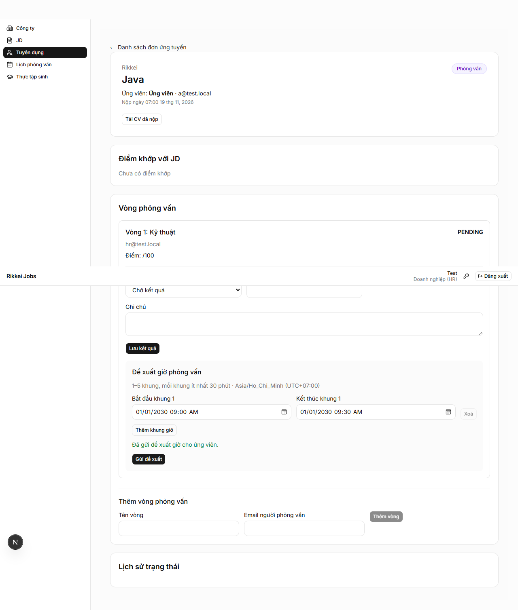
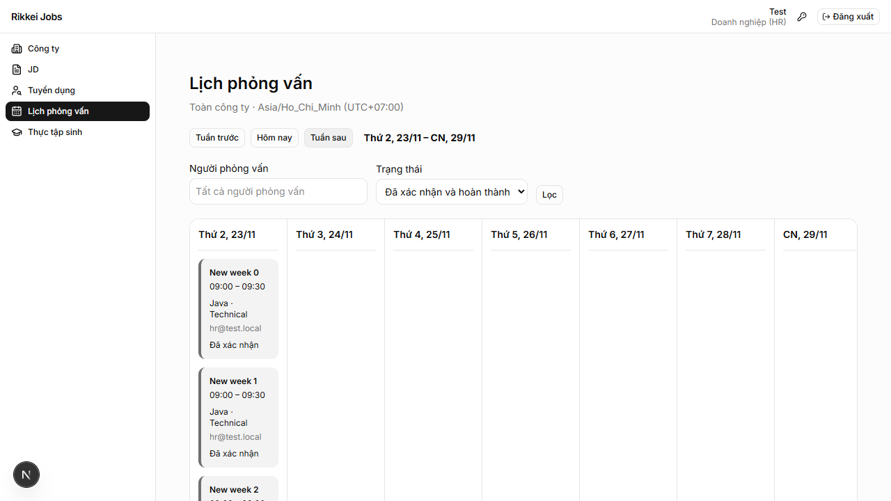
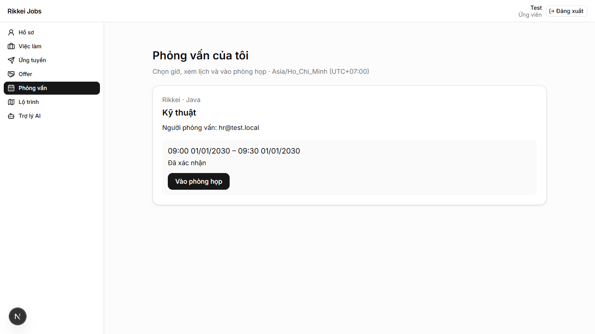
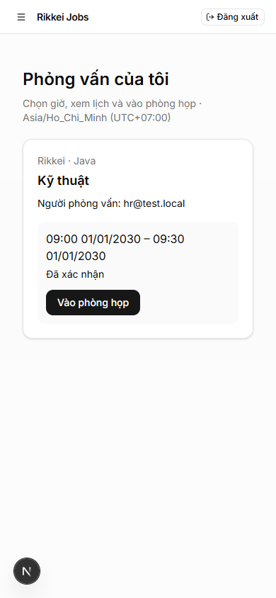

# UT-06 — Đặt lịch và nhắc phỏng vấn

## Chạy và cấu hình

UT-06 mở rộng UT-02 trong recruitment-service, dùng PostgreSQL/Flyway V6/V7, mock Rikkei Meet và SMTP chung của repo. Yêu cầu JDK21, Maven3.9+, Node24 và dependency `mock/`, `web/`.

```powershell
npm ci --prefix mock
npm ci --prefix web
docker compose --env-file .env up -d --build postgres mailhog mock identity-service company-service profile-service recruitment-service api-gateway
npm --prefix web run dev
```

Tạo `.env` từ `.env.example` nếu chưa có. Không ghi đè `.env` đang dùng. Xem [UT-02](UT-02-application-pipeline.md) để chuẩn bị đơn ở trạng thái INTERVIEW và vòng PENDING; dùng tài khoản HR cùng công ty và tài khoản ứng viên sở hữu đơn. Task này không chèn giả bản ghi của các service khác.

| Biến | Ý nghĩa |
| --- | --- |
| RIKKEI_MEET_URL | URL khi chạy backend ngoài Docker, mặc định http://localhost:9000 |
| DOCKER_RIKKEI_MEET_URL | Override URL trong Compose, mặc định http://mock:9000 |
| RIKKEI_MEET_SERVICE_KEY | X-Service-Key; mặc định dùng LMS_SERVICE_KEY, phải bằng SERVICE_KEY của mock |
| MEET_CONNECT_TIMEOUT_MS / MEET_READ_TIMEOUT_MS | Timeout mặc định 2000/5000ms |
| INTERVIEW_JOBS_ENABLED | Bật cả job 15 phút và worker email, mặc định true |
| MAIL_HOST / MAIL_PORT / MAIL_FROM | SMTP hiện có; local mặc định localhost:1025, Compose dùng mailhog |
| WEB_BASE_URL | Link điều hướng trong email |

Job lấy thời gian từ Clock server, cron `0 */15 * * * *`; worker gửi mỗi10s, batch tối đa20, lease60s, tối đa5 lần thử với khoảng60/300/900/3600s. Sau5 lần chuyển FAILED và log ID/lần thử. Vận hành có thể kiểm tra bảng `recruitment.interview_notification_outbox` và trả hàng FAILED về PENDING với `attempts=0,next_attempt_at=now()` sau khi khắc phục SMTP; chỉ thao tác trên hàng xác định và kiểm tra nguy cơ SMTP đã nhận mail trước đó.

Migration V6 tạo slots, schedules và outbox; V7 thêm claim_token để fence từng lần worker nhận email. Không tự biến scheduled_at cũ thành lịch đã xác nhận. UT-02 vẫn đọc/nhận scheduledAt cũ để tương thích; form mới bỏ nhập giờ trực tiếp. Lịch UT-06 là nguồn giờ chính khi đã được ứng viên chọn.

## Hợp đồng và luồng

[OpenAPI](ut06-openapi.yaml) · [request mẫu](UT-06.http). Qua gateway dùng `/api/v1/recruitment`; gọi trực tiếp service dùng `/recruitment`.

[Kết quả kiểm chứng và các quyết định kỹ thuật](UT-06-verification.md).

1. HR gọi POST `/rounds/{roundId}/slots` với **mảng** 1–5 `{startAt,endAt}`. Giờ ISO8601 có offset, bắt đầu trong tương lai, thời lượng >=30 phút. Không chồng lấn trong danh sách. Input lỗi400, không lưu một phần. Đề xuất đầu tiên trả201; đã có đề xuất thì409 và dùng reschedule.
2. Ứng viên GET `/me/interviews?page=1&size=20` nhận lời mời, các khung OPEN còn hiệu lực và lịch hiện tại.
3. POST `/me/interviews/{roundId}/pick` body `{slotId}` tạo phòng Meet, lịch SCHEDULED, slot PICKED, CANCELLED các khung khác; trả200 với meetUrl. Cả hai bên nhận xác nhận kèm ICS qua outbox.
4. POST `/rounds/{roundId}/reschedule` nhận cùng mảng khung mới; huỷ lịch/khung cũ ngay và tạo đề xuất mới trong cùng transaction, trả200. Input lỗi giữ nguyên dữ liệu cũ. Chỉ thay đổi với đơn INTERVIEW/vòng PENDING.
5. HR GET `/companies/me/interviews?from=...&to=...&interviewerEmail=...&status=...&page=1&size=20` xem toàn công ty. Từ/đến có offset, `from<to`; lấy buổi giao với khoảng `[from,to)`, mặc định SCHEDULED/DONE, có thể lọc CANCELLED. Response `{items,total,page,size}`, size1–100; UI lấy đủ trang.

Không dùng companyId/userId do client gửi để phân quyền. Sai role403; tài nguyên ngoài quyền hoặc slot không thuộc vòng404; slot hết giờ/huỷ, trùng lịch hoặc vòng/đơn không còn cho phép409. Lỗi Meet503 và dữ liệu lịch rollback. API pick lặp cùng slot của lịch hiện tại trả cùng kết quả, không thêm phòng/mail. Slot của lịch đã huỷ409.

Overlap kiểm tra theo ứng viên và email người phỏng vấn đã chuẩn hoá, trên mọi lịch SCHEDULED trong hệ thống. OPEN chưa giữ chỗ; có thể nhận409 khi một vòng khác vừa đặt trước. Buổi09:00–09:30 và09:30–10:00 không trùng. Application/round/resource locks ngăn hai request commit lịch chồng nhau.

Lịch PASS/FAIL được đánh dấu DONE theo kết quả UT-02; trả về PENDING không tự khôi phục. Đơn rời INTERVIEW huỷ lịch còn hoạt động. Ngừng nhắc lịch CANCELLED/DONE. Muốn đặt lại dùng reschedule.

## Email và nhắc lịch

- Lời mời chọn giờ: ứng viên, link màn chọn giờ, chưa có ICS vì chưa chốt giờ.
- Xác nhận: ứng viên và interviewerEmail, loại trùng email không phân biệt hoa/thường; kèm ICS REQUEST và link Meet.
- Huỷ lịch: gửi ICS CANCEL cùng UID, SEQUENCE tăng, cho người đã nhận hoặc có lần gửi xác nhận chưa biết kết quả. Khung mới tạo lời mời mới cho ứng viên.
- Nhắc24h: lần chạy đầu khi còn `>1h` đến `<=24h`. Nhắc1h: lần chạy đầu khi còn `>0` đến `<=1h`. Nếu hệ thống chạy lại muộn, chỉ gửi mốc hiện tại.
- Đặt khi còn<=1h: xác nhận thay nhắc1h, lưu `reminder_1h_suppressed`; không giả lập thời điểm gửi trong reminded_1h_at.
- Unique key lịch/mốc/người nhận và claim/lease ngăn job lặp hoặc nhiều worker tạo/gửi lại hàng SENT. Timestamp reminded_* chỉ ghi sau khi tất cả người nhận của mốc đã SENT; người lỗi được thử lại riêng.

Giới hạn được chấp thuận: SMTP có thể nhận mail trước khi tiến trình dừng mà DB chưa lưu SENT, nên không cam kết exactly-once qua mọi crash hoặc thứ tự tới hộp thư. Message-ID cố định hỗ trợ đối chiếu nhưng không ép hộp thư khử trùng. Mock Meet có idempotency theo slotId trong bộ nhớ tiến trình; reset/restart xoá bộ nhớ đó. Huỷ trong ứng dụng không vô hiệu hoá URL Meet đã gửi vì nhà cung cấp chưa có API revoke.

## Giao diện

HR mở `/hr/recruitment/{applicationId}` và đề xuất giờ trong từng vòng. Khi đổi lịch phải xác nhận lịch cũ bị huỷ ngay. `/hr/interviews` có tuần trước/sau/hôm nay, bộ lọc người phỏng vấn/trạng thái. Ứng viên mở `/candidate/interviews`, chọn một khung và xác nhận; 409 tải lại lời mời. Nút vào phòng chỉ hiện với lịch SCHEDULED hiện tại. Mọi giờ hiển thị Asia/Ho_Chi_Minh, không phụ thuộc múi giờ máy người dùng.






## Kiểm chứng tái lập

```powershell
# Chỉ dùng PostgreSQL test riêng: suite có cleanup bảng.
# Có thể dùng UT01_TEST_DB_URL/USER/PASSWORD; không đặt thì dùng Testcontainers.
mvn -f server/pom.xml -pl services/recruitment-service -am test
npm --prefix mock test
npm --prefix web run type-check
npm --prefix web run lint
npm --prefix web run test:e2e -- ut06-interviews.spec.ts ut02-hr-workflow.spec.ts ut07-offer-flow.spec.ts
npm --prefix web run build
```

`InterviewLiveFlowTest` mở server Spring ở cổng ngẫu nhiên, tự chạy **Express mock thật của repo** và SMTP sink TCP trong test. Nó gọi HTTP thật để chứng minh: đề xuất/chọn, rollback sau tạo phòng rồi retry cùng phòng, slot huỷ409, hai MIME/ICS xác nhận, calendar, nhắc1h một lần và huỷ lịch. Test dùng mock identity/job/profile bên ngoài phạm vi UT-06, không xác nhận SSO hoặc hộp thư Internet. `TestSmtpServer` chỉ nằm trong src/test, không chạy ở production.

Concurrency tests dùng PostgreSQL và latch, kiểm tra trùng ứng viên/người phỏng vấn ở hai đơn và các buổi nối tiếp. Playwright dùng response fixtures để kiểm tra UI riêng, chạy trình duyệt ở America/New_York vẫn hiển thị đúng giờ Việt Nam; không coi fixture UI là bằng chứng backend. Node mock tests kiểm tra replay key, payload khác409 và reset. CI backend cài Node24/mock dependencies trước Maven để chạy live-boundary test.

Dữ liệu demo UI được tái tạo bởi `web/e2e/ut06-interviews.spec.ts`; ảnh sử dụng dữ liệu kiểm thử. Demo live dùng đơn/vòng thật đã tạo qua UT-02, tạo giờ tương lai bằng script `scripts/ut06-propose-demo.ps1` hoặc sửa thời gian trong request mẫu, tránh phụ thuộc ngày cố định.
