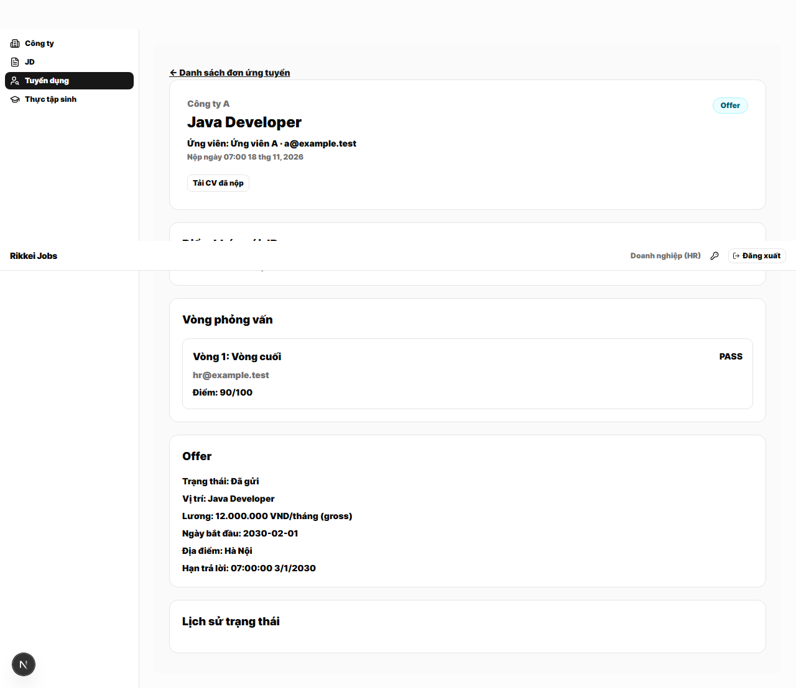
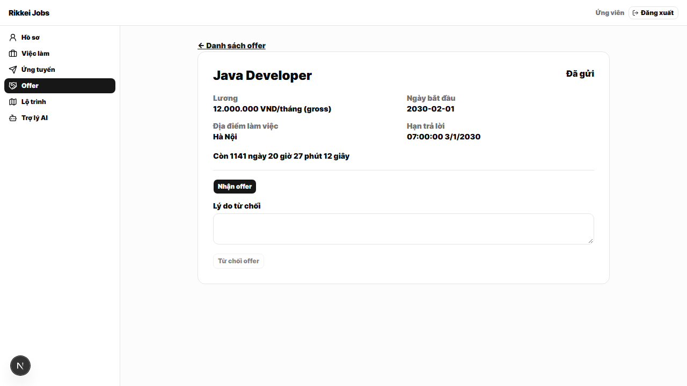
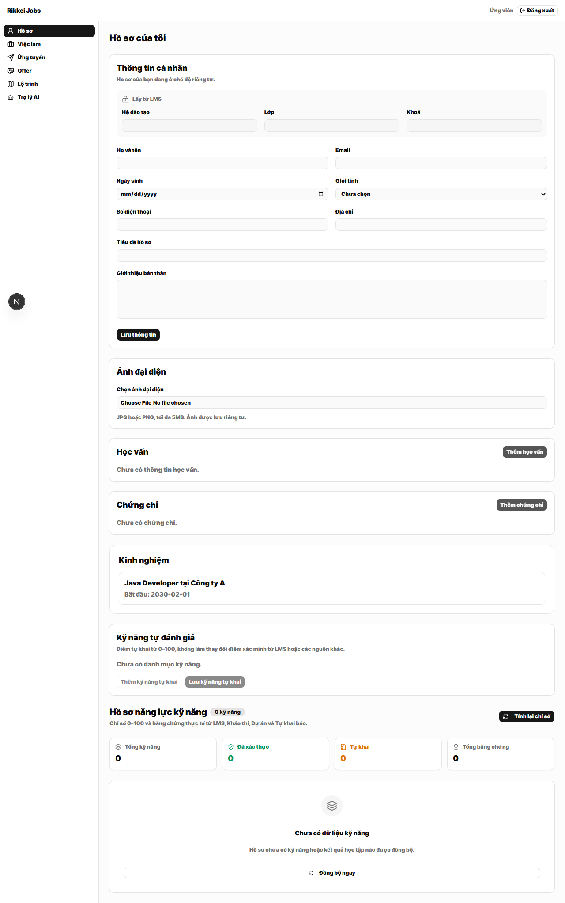

# UT-07 — Offer và ghi nhận việc làm

## Chạy thử

Yêu cầu JDK 21, Maven 3.9+, Node.js, Docker. Từ thư mục gốc:

```powershell
Copy-Item .env.example .env
docker compose --env-file .env up -d postgres mailhog mock identity-service company-service profile-service recruitment-service api-gateway
npm ci --prefix web
npm --prefix web run dev
```

Đăng nhập HR để mở `/hr/recruitment`, chọn đơn `INTERVIEW` có vòng cuối `PASS`, gửi offer. Đăng nhập đúng ứng viên để mở `/candidate/offers`, nhận hoặc từ chối, rồi xem `/candidate/profile`. Email offer được gửi bằng outbox sẵn có; có vị trí, lương, hạn trả lời và đường dẫn tới offer. [OpenAPI UT-07](ut07-openapi.yaml) dùng base URL `/api/v1/recruitment`; Swagger UI của gateway ở `/api/docs`.

Lương là **số nguyên dương VND/tháng gross**. API nhận `salary: 12000000`, giao diện hiển thị `12.000.000 VND/tháng (gross)`. `responseDeadline` là thời điểm ISO có múi giờ; server dùng đồng hồ của mình để kiểm tra hạn, nên đồng hồ đếm ngược trên giao diện chỉ có tác dụng hiển thị. Job mỗi giờ chuyển offer `SENT` quá hạn sang `EXPIRED` và đơn sang `REJECTED`; ngay cả trước lượt job tiếp theo, API nhận/từ chối đã trả `409` khi đến hạn.

## Quy tắc và quyền

| Thao tác | Điều kiện | Kết quả |
| --- | --- | --- |
| HR gửi offer | Đơn `INTERVIEW`, ít nhất một vòng, không vòng nào `PENDING`, vòng có `roundNo` cao nhất `PASS`; HR thuộc công ty | Offer `SENT`, đơn `OFFER`, một lịch sử và email qua outbox |
| Ứng viên nhận | Đúng chủ offer, `SENT`, trước hạn | Offer `ACCEPTED`, đơn `HIRED`, một `employment_records` |
| Ứng viên từ chối | Như trên, lý do sau khi cắt khoảng trắng dài 1–1.000 ký tự | Offer `DECLINED`, đơn `REJECTED`; HR thấy lý do |
| Job hết hạn | `SENT` và đến hạn | Offer `EXPIRED`, đơn `REJECTED` |
| HR xác nhận đi làm | Offer `ACCEPTED`, đơn `HIRED`, đúng công ty | Điền `confirmed_at`; gọi lặp giữ nguyên thời điểm |

Đơn khác của cùng ứng viên giữ nguyên. Ứng viên có thể tự rút đơn theo UT-01; đơn đã ở `OFFER` phải phản hồi bằng API offer. Người khác đoán ID offer nhận `404` khi xem hoặc phản hồi. HR khác công ty nhận `404`; STAFF/ADMIN đọc chi tiết đơn nhưng trường `offer` là `null`. Giao dịch và khóa hàng ngăn hai phản hồi cùng thắng.

## Dữ liệu mẫu và ảnh

Fixture HTTP trong [web/e2e/ut07-offer-flow.spec.ts](../../web/e2e/ut07-offer-flow.spec.ts) dùng ứng viên A (`40000000-0000-0000-0000-000000000007`), công ty A (`50000000-0000-0000-0000-000000000007`), đơn Java Developer (`20000000-0000-0000-0000-000000000007`), offer lương `12000000`, bắt đầu `2030-02-01`, hạn `2030-01-03T00:00:00Z`. Test tạo các trạng thái mẫu như sau:

| Offer | Cách tạo | Đơn / hồ sơ |
| --- | --- | --- |
| `SENT` | HR gửi offer khi vòng cuối PASS | `OFFER` |
| `ACCEPTED` | Ứng viên bấm Nhận | `HIRED`, có công việc mới trên hồ sơ |
| `DECLINED` | Nhập “Đã chọn công việc khác” rồi Từ chối | `REJECTED`, HR đọc được lý do |
| `EXPIRED` | Cho deadline trong quá khứ, chạy job hết hạn trong test backend | `REJECTED`; nút Nhận bị khóa ngay khi quá hạn |

Fixture này mô phỏng HTTP và không chèn dữ liệu vào DB production. Để demo API live, cần tạo người dùng, JD, CV và đơn theo các service sở hữu trước, rồi chấm vòng PASS theo UT-02.







## Kiểm chứng

```powershell
# Dùng Docker Testcontainers hoặc PostgreSQL kiểm thử riêng qua UT01_TEST_DB_URL/USER/PASSWORD.
mvn -f server/pom.xml -pl services/recruitment-service -am test
npm --prefix web run type-check
npm --prefix web run lint
npm --prefix web run build
npm --prefix web run test:e2e -- ut07-offer-flow.spec.ts
```

Backend tests kiểm tra `409` khi chưa PASS, không nhận khi đến hạn, lý do bắt buộc, ownership `404`, phản hồi đồng thời, job hết hạn, quyền xem HR, xác nhận đi làm và email. Playwright kiểm tra gửi, nhận, từ chối, hạn trả lời và kinh nghiệm trên hồ sơ; ba ảnh trên được chụp lại từ fixture đó.
