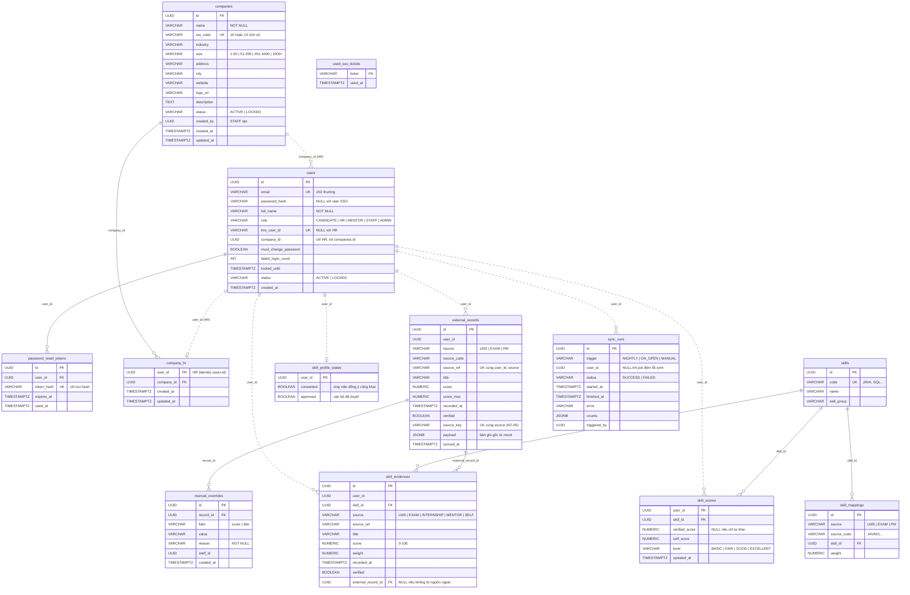

# Sơ đồ cơ sở dữ liệu (ERD)

Cập nhật file này trong cùng PR mỗi khi thêm hoặc đổi bảng. Nét liền là khoá ngoại thật; nét đứt là tham chiếu
giữa hai service (chỉ lưu id, **không có khoá ngoại vật lý**).

## Sơ đồ



## Bảng theo service

| Service | Schema | Bảng | Migration | Task |
| --- | --- | --- | --- | --- |
| identity-service | `public` | `users`, `used_sso_tickets`, `password_reset_tokens` | `V1__identity_init.sql` | NT-01 |
| company-service | `company` | `companies`, `company_hr` | `V1__company_init.sql` | DN-01 |
| profile-service | `profile` | `skills`, `skill_mappings`, `skill_evidences`, `skill_scores`, `external_records`, `skill_profile_states` | `V1__skill_profile.sql` → `V3__external_records_and_profile_state.sql` | HS-01 |
| profile-service | `profile` | `manual_overrides`, `sync_runs`; thêm `source_key`, `payload`, `synced_at` vào `external_records` | `V4__nt05_external_sync.sql` | NT-05 |

## Quy ước

- **Mỗi service một schema** trong database chung `rikkei_jobs`, cấu hình trong `application.yml` của service:

  ```yaml
  spring:
    jpa.properties.hibernate.default_schema: <service>
    flyway:
      schemas: <service>
      default-schema: <service>
  ```

  Bảng lịch sử Flyway nằm trong schema đó, nên các service migrate độc lập, khởi động theo thứ tự nào cũng được.
  `identity-service` đã merge trước quy ước này nên giữ schema `public`.
- **Tên migration** đánh số tăng dần, 3 chữ số: `V001__mo_ta.sql`, `V002__...`. Flyway so số theo giá trị, nên
  `V1__` của identity và company tương đương `V001`; migration tiếp theo của hai service này là `V002__`.
- **Không sửa migration đã merge.** Muốn đổi thì thêm migration mới.
- **Không đặt khoá ngoại giữa hai service.** Ví dụ `users.company_id` chỉ lưu id; tính đúng do seed và API tạo HR (DN-01) bảo đảm.
- **Seed** chỉ chạy với profile `dev` (`app.dev-data.enabled`), chạy lại không tạo trùng. ID cố định của dữ liệu mẫu:

  | Dữ liệu | ID |
  | --- | --- |
  | Công ty A (hr1, hr-new) | `00000000-0000-0000-0000-0000000000a1` |
  | Công ty B (hr2) | `00000000-0000-0000-0000-0000000000b2` |

## Kiểm tra từ DB trống

```bash
docker compose --env-file .env -f infra/compose.yaml up -d postgres
cd server
mvn install -DskipTests
mvn -f services/identity-service/pom.xml spring-boot:run "-Dspring-boot.run.profiles=dev"   # tạo users..., seed 9 tài khoản
mvn -f services/company-service/pom.xml spring-boot:run "-Dspring-boot.run.profiles=dev"    # tạo company.*, seed A/B + liên kết HR
```

Test tự động chạy cùng các migration trên H2 (`mvn test`), nên migration lỗi sẽ làm test đỏ.
